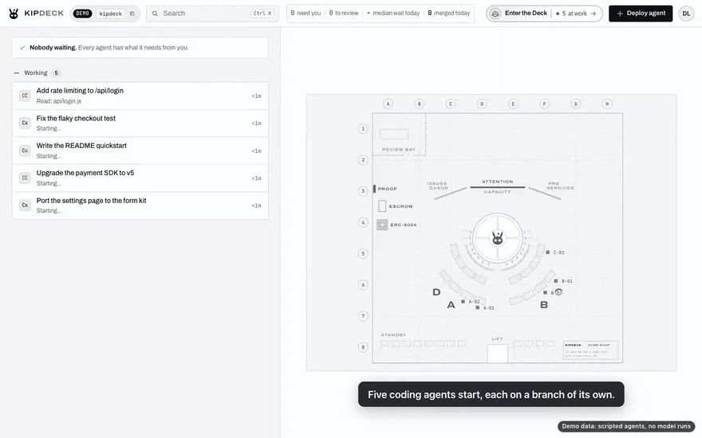
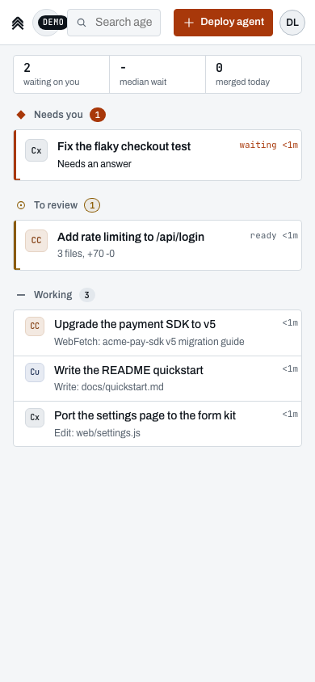
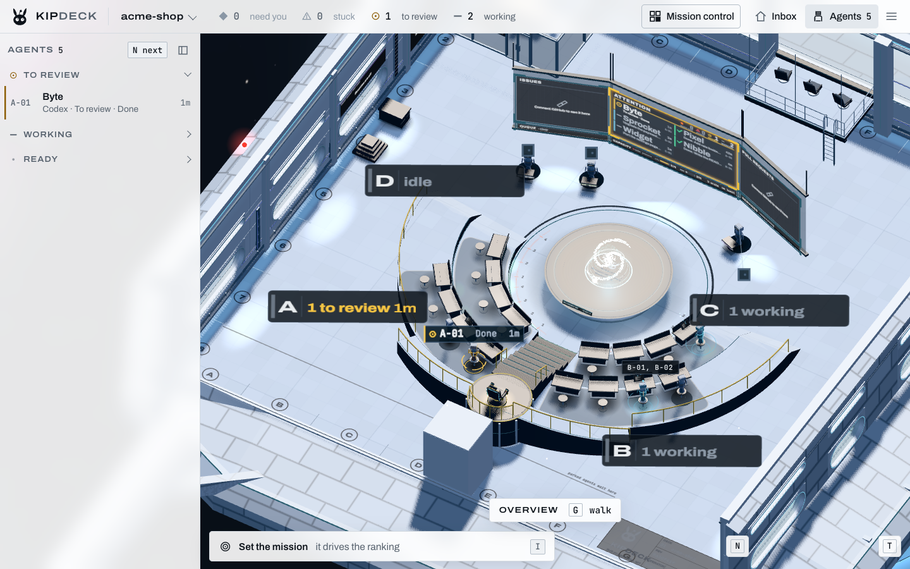

<picture>
  <source media="(prefers-color-scheme: dark)" srcset="design/logo/lockup-dark.svg">
  
</picture>

# Kipdeck

The inbox for your AI coding agents. Full control and clarity over every AI coding agent you run, in one place. See who is waiting on you and for how long, then answer, review and merge without leaving it.

```bash
npx github:zbagdzevicius/kipdeck
```

> Not on npm yet: the name waits on a trademark search ([business/naming.md](business/naming.md)). Until it is published, npx runs it straight from this repository. The first run installs and builds it, which takes a few minutes; after that the terminal prints the exact command for everything else (a new sign-in link, attach). Or [run it from source](#from-source).



No agents yet? `npx github:zbagdzevicius/kipdeck --demo` plays five scripted ones on a throwaway repository, no CLI, sign-in or model needed ([the demo](docs/demo.md)). Or watch a recorded round in the browser, with nothing to install: https://kipdeck-demo.vercel.app

Run it inside the repository you work in. It opens in your browser, signed in, with that repository as your first project. Claude Code, Codex and Cursor run side by side (OpenCode, Pi, Grok, Muse and DeepSeek Harness in beta), each on a branch of its own, and you answer, review and merge from one page, on your laptop or your phone. It runs on your machine or your team's dev box, and nothing leaves it.

[**Run it**](#run-it) · [**Try the demo**](docs/demo.md) · [**Attach an agent**](#attach-an-agent-you-already-started) · [**Teams and servers**](docs/self-hosting.md) · [**Labs**](#labs) · [**Docs**](docs/features.md)

- **One loop.** **Deploy agent**, get pinged when it needs you, answer its question in one box, read its review brief (what it was asked, what it says it did, your answers, its test runs and what in the diff is risky) over the diff beside the list and Merge, and it lands in **Shipped today**. The oldest agent waiting on you opens by itself, and with nothing selected the pane shows the next item that needs you, or All clear with Kip keeping watch, one warm line and the day so far (he steps aside the moment anyone needs you, and cheers in the toast when a merge lands); the top bar says how many need you and how many are ready to review, with the oldest wait ticking, the median wait today and what merged today. Merge waits a few seconds for Undo and names where it goes. Answer or approve one and the pane moves on to the next that needs you, then the next to review, as it does after a merge. See [the inbox](docs/inbox.md).
- **One ranking, one set of names.** `src/shared/attention.ts` decides the order and names the five states everywhere: Needs you, Stuck, To review, Working and Idle. The inbox's sections (Needs you with the stuck ones in it, To review, Working, Idle), Mission control, the tab title and notifications all read from it ([the inbox](docs/inbox.md) has the full list).
- **Spend and control.** Each row shows the agent's permission mode (`bypass`, `auto`, `edits`, `ask`, `plan`, read off the command line it started with) and what it has spent, with `cost ?` for a CLI that reports none. The pulse has today's spend. Admins set a default mode per project and budget caps per agent and per day in Settings: a warning at 80 percent, and at 100 percent the agent is paused into Needs you until an admin lets it continue. **Pause all** in the top bar (and Ctrl+K) pauses, resumes or stops every agent, with Undo. See [spend and control](docs/spend.md).
- **A record of what shipped.** Every merge and send-back is kept on your machine as a signed record: which agent and model, the prompt, and who reviewed it. **Numbers** shows human wait time and the merge rate per agent and model from it.
- **The Deck.** With its lab on, **Enter the Deck** in the avatar menu (or **D**) takes you to `/deck`: the same agents at their stations on a 3D starship bridge, a wall display for a team room. It and the rest beyond the inbox (goals and the timeline, meetings, voice, Rundown, Proof of Merge on testnets) are [Labs](#labs), all off as Kipdeck ships; an admin switches on what a team wants.

| | |
| --- | --- |
|  |  |
| The same inbox on a phone. | The Deck at `/deck`: the same agents as a room, for a team's wall screen. The old `/bridge` address still lands there. |

## Run it

You need **Node.js 20+**, **git** and one agent CLI: **Claude Code** (`npm install -g @anthropic-ai/claude-code`), **Codex** (`npm install -g @openai/codex`) or **Cursor** (`cursor-agent`), signed in. The **GitHub CLI** (`gh`) is optional: with it, agents open pull requests and the inbox shows their checks; without it, review reads the local diff and Merge merges on your computer.

In the repository you work in:

```bash
npx github:zbagdzevicius/kipdeck
```

1. It says `Starting Kipdeck...` at once and a line for each slow step, then starts on `http://localhost:4600` (or the next free port) and opens your browser, **already signed in**. On your own computer there is no password to type: the link it opens works once, and the terminal prints the command that makes a new one if you lose the tab (`open`, typed the way this copy runs: `kipdeck open` once it is on your PATH, otherwise `node <path>/bin/agent-office.js open`, with `--home` for an office outside `~/agent-office`). A used or stale link opens the same page with that command on it, never a password form. Only your computer can reach it. Ctrl+C stops it and its agents, and says how many merged this session.
2. The repository you started it in is your first project. Started somewhere else, the setup card offers to clone one from GitHub.
3. The **setup card** (*Give your first agent a job*) says which agents it found and whether each is signed in, the project, and GitHub, with the one line to run for anything that isn't ready.
4. **What were you about to ask Claude Code?** Type the task, or pick one of three suggestions drawn from the repository (its newest open issue, its failing tests, a TODO, a gap in its README), and **Deploy your first agent**. It shows up under **Working** within seconds, under **Needs you** when it has a question, and under **To review** when it's done. The pane beside the card shows those three steps.
5. Already running Claude Code in a terminal here? The card offers **Bring in N sessions**: each carries on in the inbox with its conversation so far, and your terminal keeps running.

Nothing asks you anything in the terminal, and there are no settings to fill in. From a clean machine to the first agent at work takes under two minutes once it is installed; until it is on npm the first `npx` run also builds it, a few minutes more. `design/time-to-first-agent.mjs` times it (from a local `npm pack` tarball until the package is on npm).

### From source

A clone runs the same way, and starts in seconds every time. `npm install` builds it:

```bash
git clone https://github.com/zbagdzevicius/kipdeck ~/kipdeck
cd ~/kipdeck && npm install
cd ~/code/your-project && node ~/kipdeck/bin/agent-office.js      # or: npm link once in ~/kipdeck, then kipdeck
node ~/kipdeck/bin/agent-office.js --demo                         # the demo, anywhere
```

The demo's coach strip ends at *Run it on your repo* (*That's the loop. Now run it on your repo.* once you've answered and merged) with the command you started the demo with, without `--demo`, to copy.

From here on, `kipdeck` stands for the way you run it: `npx github:zbagdzevicius/kipdeck`, `node <clone>/bin/agent-office.js`, or `kipdeck` once it is on your PATH (`npm link` in the clone). `kipdeck --help` says which one you used, and every command Kipdeck prints is already in that form.

Common options:

```bash
kipdeck --port 4700                 # this port or nothing
kipdeck ~/code/my-project           # keep the office's data in that project, as agent-office did
kipdeck --host 0.0.0.0              # let your network in (others sign in with a password, or pair a phone)
kipdeck --password 'correct horse'  # a password, even on this computer
kipdeck --no-open                   # print the sign-in link instead of opening a browser
kipdeck --telemetry                 # share anonymous usage numbers (off by default)
kipdeck --labs proof                # turn on Proof of Merge (testnets), the Colosseum entry's payout layer
```

`kipdeck rundown [path]` writes a project's map (its parts by status, inferred from the code, no Claude needed) into `.rundown/`, and `kipdeck rundown install` adds the `/rundown` skill to Claude Code for Claude's own read; see [docs/rundown.md](docs/rundown.md).

Once it is on npm, to have a `kipdeck` command instead: `npm install -g` with its package name, or [`install.sh`](install.sh) (macOS and Linux) and [`install.ps1`](install.ps1) (Windows), which install the same package. Until then those print the from-source steps above, and `npm link` gives you the same command. Every option is in [docs/configuration.md](docs/configuration.md); choosing models and providers per agent is in [docs/agents.md](docs/agents.md).

## Attach an agent you already started

Claude Code running in a terminal in one of your projects' folders shows up on the setup card: **Bring in** carries it on in the inbox as a copy of the session (`--fork-session`), and the terminal keeps going, so nothing has to be quit. For Codex, which can't share a session that is still running, or to do it from the terminal, quit the agent there (Ctrl+C or `/exit`), then in the same folder:

```bash
kipdeck attach
```

It finds that folder's newest Claude Code or Codex session in the CLI's own files, and the running Kipdeck carries it on as one of its agents: the same conversation, now in the inbox with its terminal, its questions, its changes and the merge. `--list` shows the folder's sessions, `--session <id>` picks one, and Cursor needs `--agent cursor --session <id>` (`cursor-agent ls` lists them).

## Labs

Labs are the parts beyond the inbox. Each is off as the office ships, so a first visit sees the inbox and nothing else. An admin switches any of them on for everyone from **Labs** at the foot of the avatar menu, **Open Labs...** at the foot of Settings > Account (or Labs in Ctrl+K) or the Deck's menu, and the choice is kept in the office's `labs.json` (an office that saved its labs before keeps them); `--labs bridge,ops` (or `AGENT_OFFICE_LABS`) holds some on from the command line so nobody can switch them off, and `--labs -proof` (or `--labs none`) holds them off. Turning one off hides it; nothing is deleted. A lab being on never asks the browser for anything by itself: the microphone and screen sharing wait for your click, sound for your first click or key, and Proof of Merge stays on testnets and sends nothing anywhere until an admin sets up its keys and flags.

| Lab | What it brings (switching it off hides it) |
| --- | --- |
| GitHub boards and queue | Issues, Pull requests, the Task queue and Mission control in the home page's avatar menu and Ctrl+K. |
| Deck (3D) | **Enter the Deck** in the avatar menu's Labs group (and **D**, and Go to Deck in Ctrl+K), and a small deck plan under the work in the empty pane. `/deck` itself always opens. |
| Goals and timeline | Goals and milestones, the Timeline and Records tabs in Mission control, the Deck's mission strip and the Services board. |
| Meetings | The Review bay and the planning whiteboard. |
| Voice | Voice chat, screen sharing and the dictation mic in prompt boxes and terminals. |
| Deck ambience | The Deck in full: mascot, ship's voice, hands, celebrations, start of watch, ship motion and the ambience bed (from your first click or key). Off, the Deck starts calm. |
| Rundown | A map of each project: its parts by status, milestones, commit activity, branches and the decisions waiting on you, in the inbox (avatar menu and Ctrl+K) and as a city of light over the Deck's holo table. The office builds each project's first map by itself, so the window opens with data and Signal shows the parts. The same map the `/rundown` Claude Code skill draws, which ships in the package (`kipdeck rundown install`); see [docs/rundown.md](docs/rundown.md). |
| Proof of Merge (testnets) | Bounties and payouts, attestations, ERC-8004 reputation, x402 paid tasks and `/pom/`. Their HTTP routes don't exist and their socket messages go nowhere while it's off. Any chain flag (`--x402`, `--attest`, `--reputation`) holds it on. The Proof corner, the ledger and the payout counter show only once bounties or a chain flag are set up. |

More in [docs/labs.md](docs/labs.md).

## What it does

- **The inbox.** Every agent in four sections (Needs you, To review, Working, Idle), one button per row, the selected agent's live terminal, diff and log beside the list, and Shipped today under it ([the inbox](docs/inbox.md)). With nothing waiting it greets you by the time of day and says All clear; it thanks you after an answer and counts merges on today's tape, and goes quiet the moment someone needs you ([the crew voice](docs/voice.md)). It loads under 250 kB before it draws, on any laptop or phone; the old `/lite` address goes there.
- **Approvals from the hook.** When Claude Code asks permission to run a tool, the inbox shows an Approval card with the exact command or files, where it runs and risk tags (destructive, network, outside the repo, secrets). Allow once, Always allow with the rule it adds, or Deny with a reason, each answer bound to that request. Agents without a permission hook still ask in their terminal, read off the screen and labelled as such ([the inbox](docs/inbox.md#approvals)).
- **Deploy, attach, answer, review, merge.** The Deploy sheet starts an agent on a branch of its own; `kipdeck attach` adopts one started in a terminal; Answer, Review changes, Fix checks and Merge do what they say, with or without GitHub. Review opens with a brief over the diff: one confident Merge when the agent's tests passed and nothing is flagged, the gap in plain words when not, and line comments that go with Send back. With a GitHub repository and no pull request yet, Open PR comes first. On a team, each row says whose agent it is, and **Mine / Team** filters the inbox.
- **Your phone.** **Pair a phone** (avatar menu, or Ctrl+K) shows a QR code that signs your phone in once, without a password; the phone stays signed in until you revoke it under Settings > Account > Paired devices. Every agent has its own address (`/a/<project>/<agent>`, a project is `/p/<project>`), so Back closes what you opened, a link opens the same agent on another device, and the team channel's posts link to the agent once the office has a secure address ([on your phone](docs/inbox.md#on-your-phone)).
- **Numbers.** Human wait time, changes merged, the merge rate and agent-hours, the last 7 days against the 7 days before, and the merge rate per agent and model with its N, from the signed shipped log on your machine ([metrics](docs/metrics.md)).
- **Settings in three panes.** Account, Agents and Notifications. Seven keys, and Help on **?** ([controls](docs/controls.md)).
- **Push to your phone.** Kipdeck installs as an app, and an agent that needs an answer, wants an approval, has work to review or is stuck reaches your devices with a push titled by its task. A request with no risk tags can be allowed or denied from the lock screen, once, for 10 minutes. The first Deploy asks once; Slack or Discord hears only if the push goes unanswered for a few minutes with nobody at a Kipdeck tab ([push](docs/push.md)).
- **Teams.** Accounts with invite links, a shared dev box reached by SSH tunnel or Tailscale, and the team's Slack or Discord channel ([below](#teams-and-servers)).
- **Agents that manage agents, with you in charge.** Every agent can list the others through the `kipdeck` MCP server or the `office-workers` command ([agents](docs/agents.md)). When one asks to deploy, message or stop another, the request waits in Needs you with its full text until you approve or reject it, unless an admin gave that project a standing permission in Settings > Agents; every such action is on a record there ([agents acting on agents](docs/agent-gate.md)).
- **Mission control** (with the GitHub boards and queue lab on): the same ranking with reminders, the review inbox and the digest of what happened while you were away ([mission control](docs/mission-control.md)).

Everything else, the 3D Deck with its crew, moments and ambience, goals and the timeline, meetings, voice and Proof of Merge on testnets, is in [Labs](#labs) (all off until an admin switches them on) and described in [features](docs/features.md).

## Teams and servers

The same inbox runs on a server for a team: everyone reaches it through an SSH tunnel or Tailscale, with their own account. One script each for [AWS](docs/self-hosting.md#deploy-to-aws-ec2), [Azure](docs/self-hosting.md#deploy-to-azure), [Railway](docs/self-hosting.md#deploy-to-railway), [Fly.io](docs/self-hosting.md#deploy-to-flyio), [Dokploy](docs/self-hosting.md#deploy-to-dokploy) and [any Ubuntu or Debian machine](docs/self-hosting.md#deploy-to-any-ubuntu-or-debian-server), all in [docs/self-hosting.md](docs/self-hosting.md). Off your own computer the office asks for a password or an account, never a sign-in link.

## Add users

Everyone gets their own account, so their name is on their operator, in chat and on every terminal they type into.

**1. On a server, let them in first.** On a [Tailscale](docs/aws.md#tailscale) office, everyone on your tailnet can already open it. For someone who isn't, share the machine with them from Tailscale's Machines page: **Invite teammates** (Ctrl+K) says how. Skip to step 2.

Otherwise the office is only reachable through an SSH tunnel, so a teammate needs their SSH key on the machine. In the office, open **Invite teammates** (Ctrl+K) and type their GitHub username. On AWS, Railway, Fly.io or Dokploy you can also do it from your terminal:

```bash
deploy/aws.sh invite octocat        # installs the keys from github.com/octocat.keys
deploy/aws.sh allow 203.0.113.7     # their IP ("allow anywhere" opens SSH to every IP)
deploy/railway.sh invite octocat    # on Railway, SSH answers every IP already
deploy/fly.sh invite octocat        # and on Fly.io
deploy/dokploy.sh invite octocat    # and on Dokploy
```

It prints the command to send them. They leave it running and open http://localhost:4600:

```
ssh -L 4600:localhost:4600 office@<your-office-ip>
```

(On Railway and Fly.io the address carries a port of its own, like `ssh://office@zephyr.proxy.rlwy.net:17738`. On Dokploy it's the server's SSH port for the office: `ssh://office@203.0.113.7:2222`.)

Their key logs in as a locked-down `office` user that can only forward to the office port: no shell, no other ports. Running the office on your own computer, or on your own domain over HTTPS? Skip this step.

A teammate with Kipdeck on their computer can run `kipdeck tunnel office@<your-office-ip>` instead of the `ssh` line: it opens the same tunnel, and every web server a worker starts opens on their computer too ([docs/tunnel.md](docs/tunnel.md)).

**2. Make them an account.** Open **Accounts** (Ctrl+K) and make an invite link. Name it (or let them pick) and make them a *Member* or an *Admin*. The link works once, for 7 days, and they choose their own password. Make one for yourself too, as an admin.

The same works from a terminal on the office's machine, even while it runs:

```bash
kipdeck accounts                      # accounts and open invites
kipdeck accounts invite ada --admin   # prints a single-use /join#... link
kipdeck accounts role ada member
kipdeck accounts revoke ada           # signed out within seconds
```

On the EC2 machine, run it through `deploy/aws.sh ssh` (on Azure, `deploy/azure.sh ssh`):

```bash
deploy/aws.sh ssh 'node /opt/agent-office/bin/agent-office.js accounts invite ada --dir "$(cat /etc/agent-office/home)"'
deploy/railway.sh ssh 'node /opt/agent-office/bin/agent-office.js accounts invite ada'   # on Railway
deploy/fly.sh ssh 'node /opt/agent-office/bin/agent-office.js accounts invite ada'       # on Fly.io
deploy/dokploy.sh ssh 'node /opt/agent-office/bin/agent-office.js accounts invite ada'   # on Dokploy
```

**Their own Claude and GitHub.** With accounts, everyone's workers run on their own Claude plan, and the office acts on GitHub as them: comments, merges, labels, pushes and pull requests show up under their name. The first time someone comes in, **Your sign-ins** opens (it's under Menu > Deck too). *Sign in with Claude* gives them Claude's sign-in page and takes back the code it shows. *Sign in with GitHub* shows a one-time code for github.com/login/device. They can paste a token from `claude setup-token`, or a GitHub token, instead. A shell they open at a console runs as them, so `claude auth login` and `gh auth login` typed there work too. Admins can use the office machine's own sign-ins instead. Each account's sign-ins live in `.agent-office/homes/<account>/`, and revoking the account deletes them. The boards are read with the machine's own `gh`, so that account needs read access to the repos. Running it just for yourself, with no accounts, none of this applies.

**3. Turn off the shared password.** Until you do, anyone who knows the shared password can get in, as an admin. Once everyone has an account, switch it off in **Accounts** (signed in with your own admin account), or `kipdeck accounts password off`.

**Removing someone.** Revoke their account in **Accounts** (or `kipdeck accounts revoke <name>`), and on a server also remove them in **Invite teammates** (on AWS, `deploy/aws.sh uninvite <name>`; on Railway, `deploy/railway.sh uninvite <name>`; on Fly.io, `deploy/fly.sh uninvite <name>`; on Dokploy, `deploy/dokploy.sh uninvite <name>`) to take away their SSH keys and drop open tunnels (other teammates just reconnect). If the shared password is still on, change it with `deploy/aws.sh reset-password` (or `deploy/railway.sh reset-password`, `deploy/fly.sh reset-password` or `deploy/dokploy.sh reset-password`).

## Controls

Seven keys on the home page: **Ctrl+K** (find an agent or a command), **N** (deploy an agent), **Enter** (answer or review the selected agent; it never merges), **Esc** (back to the list, or close a window), **/** (search), **?** (Help) and **D** (enter the Deck). Up and Down move the selection. Everything else is a row's button or the avatar menu: Numbers, Signal, Settings, Help and Sign out, then Labs last (also in Settings and Ctrl+K). **D** works only while the Deck lab is on. The Deck's keys (walking, the Overview, voice) are in [docs/controls.md](docs/controls.md#the-deck-labs).

## Development

```bash
npm install
npm run dev          # Vite with hot reload on :5173, the server on :4600 (password: dev)
npm run typecheck
npm test
```

The browser tests (`tests/*-e2e.test.ts`) load the built bundle, so run `npm run build` before `npm test` to include them. They skip, saying why, when there is no bundle or it is older than the sources it was built from (after an edit, a merge or a checkout).

Server edits restart the server, not the workers. After changing `ptyhost.ts`, bump `PTY_PROTOCOL` in `ptys.ts` so the next server replaces the PTY host.

[docs/code-layout.md](docs/code-layout.md) says where the code lives, and where a new feature's pieces go.

The rules for coding agents working on this repository are in [`AGENTS.md`](AGENTS.md), which Codex, OpenCode and most other agent CLIs read. `CLAUDE.md` only imports it for Claude Code, so new rules go in `AGENTS.md`.

### Publishing to npm

The npm package ships the built `dist/` (`files` in `package.json`: the app, the server, the showcase and the rundown script), so an install from npm builds nothing on the user's machine. `prepare` runs `npm run build` on `npm pack`, `npm publish` and a GitHub install (`npx github:zbagdzevicius/kipdeck`), and `publishConfig.access` is `public`, which a scoped name needs. Both bin names (`kipdeck`, `agent-office`) run the same script, so `npx <any name>` finds it. To publish under a scope you own, for example `@kipdeck/kipdeck`:

```bash
npm login
npm pkg set name=@kipdeck/kipdeck
npm pack && tar -tzf kipdeck-kipdeck-*.tgz | head    # check what ships
npm publish
```

Then, in the same release: set `NPM_PACKAGE` to that name and `ON_NPM` to `true` in `src/shared/demo.ts` (every command Kipdeck and its pages print switches to `npx <name>`), point the README's first command, `install.sh` and `install.ps1` at it, and set `KIPDECK_NPM_PUBLISHED=1` for the landing page ([docs/landing.md](docs/landing.md)). A copy started by `npx <name>` already prints `npx <name>` for itself (`src/server/runcmd.ts` reads the spec npx installed).

## More

- [The inbox](docs/inbox.md): the home page, its loop, the setup card, Numbers, Settings, its keys and the shipped log
- [Spend and control](docs/spend.md): each agent's permission mode badge, spend on rows and in the pulse, budget caps that pause an agent into Needs you, and Pause all, Resume all and Stop all
- [Push to your devices](docs/push.md): installing Kipdeck as an app, Web Push to your phone and laptop, who gets a push and when, Allow once and Deny from the lock screen, and when Slack or Discord hears after it
- [Signal](docs/signal.md): the project's status at one look over the inbox list (On track, At risk, Off track or No goal), the rules behind it, and Copy as text for Slack
- [The demo](docs/demo.md): `npx github:zbagdzevicius/kipdeck --demo` with five scripted agents, the hosted read-only demo, the replay demo at https://kipdeck-demo.vercel.app, and the scripts that make the video, the GIF and the deck's screenshots
- [Metrics for the deck](docs/metrics.md): what each number means, where it comes from, and what not to show
- [The landing page](docs/landing.md): `site/landing/` (`npm run build:site`, then `npm run preview:site`), what each section's motion shows, the one file that holds the product's name, its speed budgets (`npm run perf:site`), accessibility and search tags, the design-partner ask, and how to deploy it to Cloudflare Pages ([site/landing/README.md](site/landing/README.md))
- [Features](docs/features.md): the inbox first, then the whole office in detail
- [Controls](docs/controls.md): the inbox's keys and menu, the Deck's keys, and a terminal's
- [Agents acting on agents](docs/agent-gate.md): an agent's request to deploy, message or stop another waits in Needs you; standing permissions per project, and the activity record
- [Agents](docs/agents.md): every harness Kipdeck runs (Claude Code, Codex, Cursor; OpenCode, Grok, Muse, DeepSeek Harness and Pi in beta), models and effort, and the prompts
- [Configuration](docs/configuration.md): every command-line option, and where Kipdeck keeps its data
- [Teams and servers](docs/self-hosting.md): one script each for AWS, Azure, Railway, Fly.io and Dokploy, the one-line setup for any Ubuntu or Debian server, or by hand behind Caddy or nginx; references for [AWS](docs/aws.md), [Azure](docs/azure.md), [Railway](docs/railway.md), [Fly.io](docs/fly.md) and [Dokploy](docs/dokploy.md)
- [Workers' servers on your own computer](docs/tunnel.md): `kipdeck tunnel`, which opens every agent's web server on your computer by itself
- [Security](docs/security.md): the threat model, signing in on your own computer, and anonymous usage numbers
- [How it works](docs/how-it-works.md): the architecture, and security notes
- [Code layout](docs/code-layout.md): where the code lives, adding a feature or an agent provider, and the size guard
- [The launch kit](launch/kipdeck/README.md): the gates before launch, the posts and the design-partner outreach

Labs and the Deck:

- [Labs](docs/labs.md): what each lab brings back, and how to switch it
- [Rundown](docs/rundown.md): the project map, as the `/rundown` skill in any repository and in the office, its data model and its limits
- [Mission control](docs/mission-control.md): the attention ranking, the floor's mission and milestones, linking work to goals, the review inbox, the timeline, reminders and the digest
- [Design system](docs/design.md): each surface on screen, the motion and the deck's sound, demo mode, and how to check a design change with `design/shoot.mjs`
- [Voice](docs/voice.md): the crew voice, before and after copy, Kip's states, the signature moments and where fun is forbidden
- [The deck](docs/deck.md): what's where on the 3D deck, cell addresses, and the Overview camera
- Proof of Merge on testnets (a lab; nothing goes on chain until an admin sets up its keys and flags, and not part of the product's pitch): [bounties](docs/bounties.md), [attestations on Base Sepolia](docs/proof-of-merge.md), [ERC-8004 reputation](docs/reputation.md), [the public showcase](docs/showcase.md), [paid tasks over x402](docs/x402.md) and [the chain launch kit's tools](docs/launch.md) (archived)

## Verify the film

The 30-second film on [kipdeck.com](https://kipdeck.com) (source in [video/](video/README.md)) ends with "Try it - verify every id". These are the ids it shows, in full. Everything else on screen is tagged demo data.

| What the film shows | Full id | Look it up |
| --- | --- | --- |
| Release tx (Solana devnet) | `2rPSWQv7YSWkEwJWNJtGtpeN8WYQzHXvbPz8xb9dCbEz8LnpatSZaoYHyyyq7dgUCkmWHrU4ywFc29HPYa73ZtUc` | [Solana Explorer](https://explorer.solana.com/tx/2rPSWQv7YSWkEwJWNJtGtpeN8WYQzHXvbPz8xb9dCbEz8LnpatSZaoYHyyyq7dgUCkmWHrU4ywFc29HPYa73ZtUc?cluster=devnet) |
| Escrow program (Solana devnet) | `JAH6ZioohUJmhnTESy5TpedBPLuiGviZLhYFyQsyVQs6` | [Solana Explorer](https://explorer.solana.com/address/JAH6ZioohUJmhnTESy5TpedBPLuiGviZLhYFyQsyVQs6?cluster=devnet) |
| EAS schema (Base Sepolia) | `0x368e9023c13393aea075e78cae18e804725b0d1bb3e2b1a6c1117d759a01a900` | [EAS Scan](https://base-sepolia.easscan.org/schema/view/0x368e9023c13393aea075e78cae18e804725b0d1bb3e2b1a6c1117d759a01a900) |

What they are, and what they are not:

- **Test tokens, not USDC.** The release moved 25 of the project's own devnet test token, mint [`9CL3xM1UNUQk7XqKz8JHbYhPNH9iwZF4mU67sjSEzbMz`](https://explorer.solana.com/address/9CL3xM1UNUQk7XqKz8JHbYhPNH9iwZF4mU67sjSEzbMz?cluster=devnet), which stands in for USDC on devnet. Explorers list it as an unknown token. The film says "25 test tokens".
- **A test run, with no merge behind it.** The release is a real devnet transaction, from a demo bounty (repository `proof-of-merge/devnet-demo`, bounty account `p8cTvJgvyQ21qa7BNMaQ3Zyhkd2zah4wF5w5NZuRnKM`) that no GitHub merge triggered. The film labels it "Real devnet tx, test run". [onchain/solana/deployments/devnet.json](onchain/solana/deployments/devnet.json) records every devnet run with the same note.
- Testnets only, no real funds. The x402 scene's `0.10 test USDC` is Circle's test USDC on Base Sepolia ([onchain/x402/deployments/base-sepolia.json](onchain/x402/deployments/base-sepolia.json)).

## Upstream credit

Kipdeck is a fork of [agent-office](https://github.com/AgentSystemLabs/agent-office), created by webdevcody, Copyright (c) 2026 AgentSystemLabs, released under the MIT License. The server's architecture (projects as floors, agents and their terminals, worktrees, provider adapters, the queue, meetings, voice, accounts, the tunnel and the deploy scripts) is upstream's; [NOTICE](NOTICE) lists what this fork replaced and what remains, and [launch/chain/disclosure.md](launch/chain/disclosure.md) lists our changes commit by commit. This fork is not run by the upstream authors. The package is `kipdeck`; the `agent-office` command it also installs is the same command, so upstream's scripts keep working.

## License

[MIT](LICENSE)
