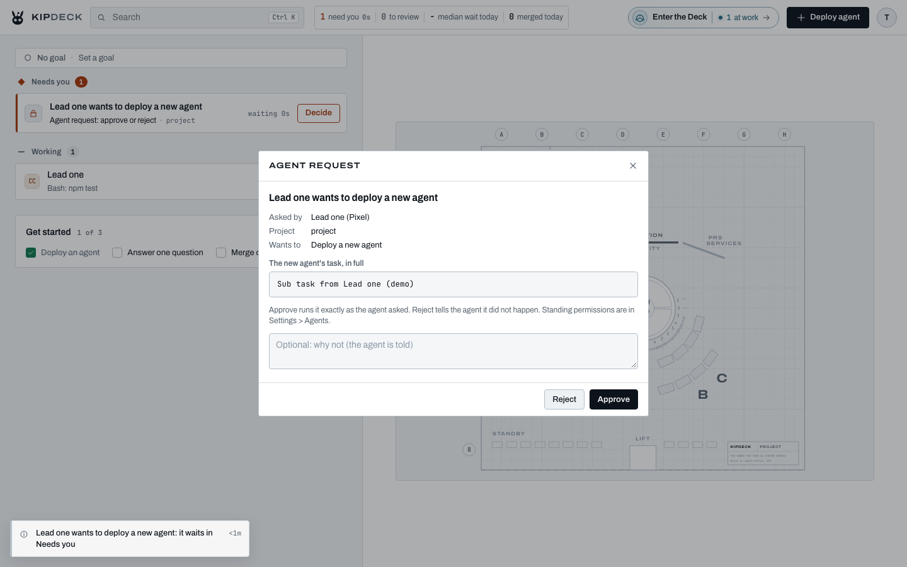
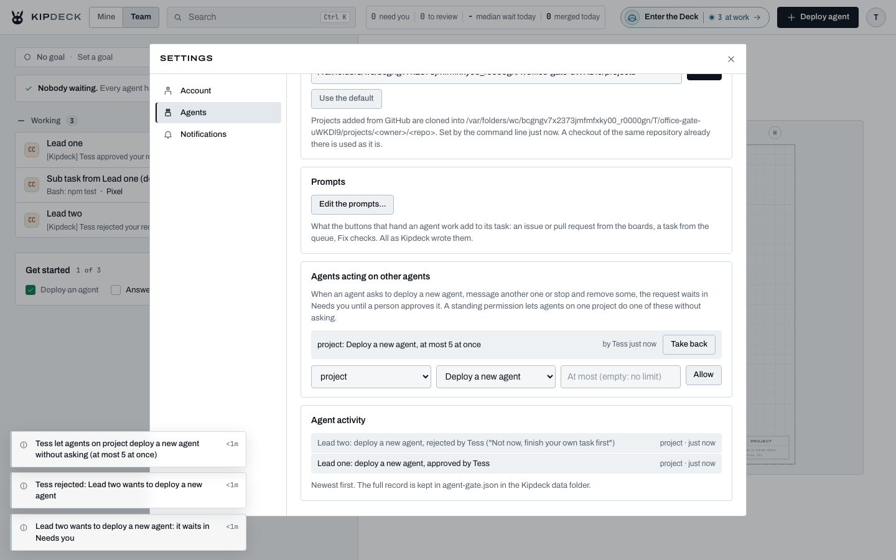

# Agents acting on other agents

What happens in Kipdeck when one agent asks to deploy, message or stop another, and how a person stays in charge of it.

Back to the [README](../README.md).

Every agent Kipdeck runs gets the `office-workers` tools (the `agent-office` MCP server, and the `office-workers` command on its PATH). With them an agent can list the other agents, deploy a new one with a task, type a message into another agent's session, and send agents home, which stops them and can delete their worktrees and branches. Those last three change what runs and what it costs, so a person decides them.

## What waits for you

When an agent calls `hire_worker`, `tell_worker` or `send_home` (or `office-workers hire`, `tell` or `home`), nothing happens yet. The request lands in the inbox's **Needs you** as a row of its own: *Fix the login wants to deploy a new agent*, with its project and a wait clock, and it counts in the pulse like any other wait on you. Everyone on the project also gets a toast.

**Decide** (or a click on the row) opens the request in full:

- who asks: the asking agent's task, and its name
- the project, and what it wants to do
- whom it is for: the agents it would message or stop, or *every agent whose pull request merged*
- the whole text: the new agent's task, or the message, however long (up to 20,000 characters)
- anything else it asked for: the agent CLI, model, effort, issue, milestone, or what becomes of worktrees

**Approve** runs the request exactly as it would have run before the gate: the same desk choice, worktree, issue claim, toasts and checks (a fork's or an outsider's pull request is still refused). **Reject** runs nothing. The window has a box for a reason. The window's close button (top right) and Esc close it without deciding, and it closes by itself once anyone else decides. The window opens with the focus on the text, not on Approve, so an Enter pressed out of habit runs nothing. If the asking agent has gone home meanwhile, the window says so; Approve still runs the request.

Either way the asking agent hears the outcome in its own session, as a message that starts with `[Kipdeck]`: *Ada approved your request to deploy a new agent (proposal 3f2a...). Hired Pixel at Desk 4 on branch office/pixel-1.*, or *Ada rejected your request to message Nova (proposal 3f2a...), so it did not happen. Their reason: Nova is busy.* An agent that has stopped is not woken just to hear this; the activity record still has it.

While it waits, the agent is told so at once: the tool answers that a person has to approve it first, that nothing has happened yet, and not to send the same request again. The `office-workers` command prints the same to stderr and exits 0. One agent can have at most 5 requests waiting at once; past that it is refused until some are decided.

Who can decide: an admin, or the account the asking agent runs as. A request from an agent that runs as the office itself (no account) is for an admin. On the shared password, everyone signed in is an admin. Visitors to the read-only demo cannot decide.

## Standing permissions

Some teams want a lead agent to fan work out without a click for every sub-agent. **Settings > Agents > Agents acting on other agents** lets an admin give a standing permission, per project and per action:

- **Deploy a new agent**, with an optional limit: the most agents that other agents deployed on that project may be running at once. At the limit the next request waits for a person again. Hires that are still starting count too, so several asked at the same moment cannot all slip under it.
- **Message another agent**.
- **Stop and remove agents**.

A request a permission covers runs at once, with no row in Needs you. One permission per project and action: a new one replaces the old. **Take back** removes it. Only admins add or take back permissions; everyone sees the list. Nothing is allowed by default.

## The activity record

Every agent-initiated hire, message and send-home goes on the record, under the permissions in the same Settings pane: who asked, what, for whom, and how it ended (waiting, approved by whom, rejected by whom and why, allowed by a standing permission, or failed and why). Settings shows the latest 20. The office keeps the last 300 in `agent-gate.json` in its data folder, with the waiting requests and the permissions, so a restart loses none of them.

## For developers

- The rules are pure: `src/shared/gate.ts` (the types, the action labels and a request's title, which the inbox loads up front) and `src/shared/gate-rules.ts` (which permission covers a request, reading limits, what the agent is told, the record in words).
- The server side is `src/server/gate/`: `store.ts` (`ctx.gate`, the waiting requests, permissions, the agent-deployed agents a limit counts, and the record), `flow.ts` (`gateOrRun` from the `/office/workers` endpoint, and `decide` from the browser) and `actions.ts` (the hire, tell and send-home themselves, moved there from the endpoint unchanged). The endpoint (`src/server/hooks/office-workers.ts`) answers 202 with `{ proposed: true, proposal, message }` for a request that waits.
- The protocol domain is `src/shared/protocol/gate.ts` (`gate.decide`, `gate.grant`, `gate.revoke`, and the `gate` state, also in the welcome), handled in `src/server/ws/handlers/gate.ts`.
- The page side is the `gate` state slice, `src/client/home/proposals.ts` (the rows), `src/client/home/proposal-window.ts` (the window, loaded when first opened) and `src/client/ui/gate-settings.ts` (the Settings rows, on the home page and the Deck).
- Tests: `tests/gate.test.ts` and `tests/gate-e2e.test.ts` (a stand-in agent asks for a hire in a real office and a headless browser approves, rejects and grants).
