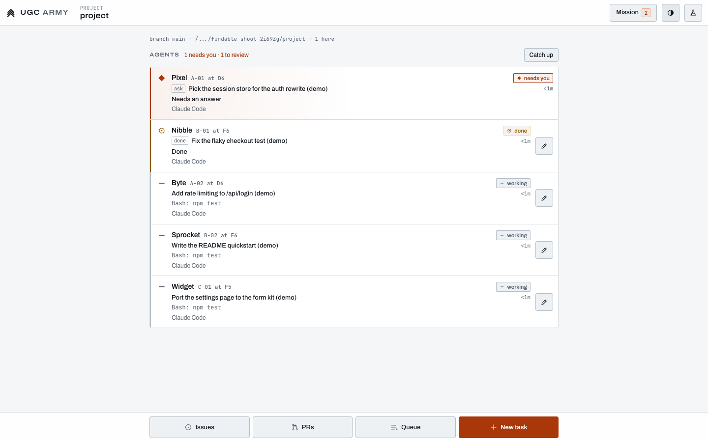

# The inbox

Kipdeck gives you full control and clarity over every AI coding agent you run, in one place. The inbox is where that happens.

Back to the [README](../README.md).

The home page at `/` is the product: one inbox for every coding agent you run. It answers three questions in order: which agent needs you, what is ready to review, and what shipped today. Everything else the office can do is reachable from the avatar menu or Ctrl+K, and the parts beyond the inbox are [Labs](labs.md).

## The five states

One set of names, in `STATE_LABEL` (`src/shared/attention.ts`), used by the home page, Mission control and the Deck's rail:

| State | What it means | Where it sits on the home page |
| --- | --- | --- |
| Needs you | It asks a question, or asks permission to run a tool (an Approval) | Needs you |
| Stuck | It crashed or went silent | Needs you, beside the questions |
| To review | Finished work, a pull request, commits with no pull request yet | To review |
| Working | At work, nothing to decide | Working |
| Idle | Waiting for a task, asleep, merged or snoozed | Idle (folded) |

"Waiting on you" is Needs you, Stuck and To review together (`waitsOnYou`): the tab title counts it on every project, and the pulse on the project in view. The tab's mark turns Signal orange only while someone is in Needs you or Stuck. A wait reads the same everywhere, on a Needs you row, the pulse, and Shipped today: seconds under a minute, then whole minutes, hours and days rounded down (`waitWords` in `src/shared/wait.ts`, `ago` in `src/shared/rowtext.ts`). A Needs you row's clock counts up each second while the page is in view; the calmer sections keep whole minutes (`<1m`). Mission control's chip counts the same agents (`attentionCounts`), so a merged pull request that only waits to be archived is not counted as to review anywhere. A wait turns aging at `WAIT_AMBER_MS` (5 minutes), the same minute the bridge goes to CONDITION AMBER by default, and stale at `WAIT_RED_MS` (30 minutes), when a row's wait bar is full. Both live in `src/shared/wait.ts`, the one source of the wait thresholds for the inbox and the bridge.

The list moves only when something changes for you (`src/client/home/motion.ts`): a new question or finished work slides in, an answered row flashes ink as it leaves Needs you, and a merge rises into Shipped today with a green edge. Each beat lasts 1.2 seconds, and with reduced motion (the system's, or Ship motion at Off) it is a cut. Signal orange marks only a person needed: focus rings, selected tabs and text selection are ink.

## One name, and the words

An agent has one name on every surface you read: its task. The row, the pane's header, a toast (*Fix the flaky checkout test is back at work.*), a dialog (*Stop "Fix the flaky checkout test"?*), a browser or Slack notification (*Fix the flaky checkout test: needs you*), Signal's next step (*Answer "Fix the flaky checkout test"*), Mission control, Rundown's worktree lanes, the timeline and the CLI all call it that. The agent CLI it runs is a badge beside the name, never the name: the two-letter mark on an inbox row (CC, Cx, Cu) and a small *Claude Code* or *Codex* chip in Mission control. With no task yet, the name is its first prompt's first line, else what it is doing (*Waiting for a task*, *Getting started*), and a sentence falls back to its CLI (*the Codex agent*). The deck's nicknames and seat codes (*Byte*, *A-01*) stay on the 3D Deck. The rules are `src/shared/agentname.ts` (`agentName` for a row, `agentRef` for a sentence, `agentBadge` for the chip, `alertTitle` for a notification), and the client's badge is `src/client/ui/agentbadge.ts`.

The words the inbox, its windows, its notifications and the CLI use:

| Say | Not | What it is |
| --- | --- | --- |
| Kipdeck | the office | The app, and one running copy of it (*This Kipdeck signs people in with their own accounts*) |
| project | floor, deck (for a repository) | A git checkout Kipdeck works on |
| agent | worker, unit, crew, persona | One coding agent working on a task, on a branch of its own |
| task | | What an agent was asked to do, and its name |
| branch, worktree | desk, console, seat | Where an agent's work lives |
| Idle | Ready | An agent with nothing to do: waiting for a task, asleep, merged or snoozed |
| Stop, Archive | send home, stand down | Ending an agent's session (Archive once its work is merged) |

`tests/one-name.test.ts` holds this: it reads every string of those surfaces (`src/client/home/`, `notify.ts`, Mission control, Signal and Rundown's windows, the Changes, queue, GitHub and stop dialogs the inbox opens, the shared ranking, Signal and reminder rules, and the server's CLI help, setup, project list, webhook, timeline, toasts and errors) and fails when one says worker, floor, desk, unit, crew, office or elevator, uses a nickname, or puts an agent's nickname or seat code into a string instead of going through `agentname.ts`. *The crew* is allowed as the whole group (you, your team, your agents and Kip) in greetings, empty states and celebrations, never for one agent ([docs/voice.md](voice.md)). Identifiers are not copy and stay: the `.agent-office` data folder, the `AGENT_OFFICE_*` variables, `office/*` branches and flags such as `--max-workers`.

### Warm moments

The inbox speaks in the crew voice of [docs/voice.md](voice.md) only when nothing needs you. Each line says its fact first; the warm clause after it sits in its own span and is left off while anyone is in Needs you (a question, a due reminder or an agent request). The words are `src/shared/warm.ts`, put on the page by `src/client/home/warm.ts`; Kip and his beats are `src/client/home/kip-moments.ts` ([Kip in the inbox](#kip-in-the-inbox)).

- **After you answer**: *Fix the flaky checkout test is back at work.* with *Thanks.* at most once a minute, and *It waited on you 12m.* under it.
- **A merge lands**: *Merged: Fix the flaky checkout test. Waited on you 32s.* then *3 on today's tape.*, with where it went under it (*Merged PR #12 into main.*). The first merge in a browser says one short sentence and nothing else: *First merge: Fix the flaky checkout test!*, with no wait, no tape count and no line under it, and a full stop in place of the exclamation mark while someone waits (`landedNote`).
- **The first job** a browser gives out, with no other agent on the roster: *Fix the flaky checkout test is aboard. It'll come back here when it needs you.* Once.
- **Back after 8 hours**: over the *While you were away* card, *Welcome back. While you were out: 4 merged, 1 waiting 2h*, the waiting part a link to the next one that needs you.
- **The all-clear pane** and **Shipped today**: the warm line and the zero-wait day (see [The page](#the-page)).

Errors, approvals, permissions, sign-in, cost and spend, Pause and Stop all, destructive confirms, undo and the *Merging in* countdown stay plain (`tests/voice.test.ts`). The words a section, row or button uses never change. An empty or error line ends with the next step (*No agent matches "x". Try fewer words, or clear the search.*).

## The first visit

`npx github:zbagdzevicius/kipdeck` in the repository you work in (or a clone's `node <clone>/bin/agent-office.js`, see the README's [From source](../README.md#from-source)) opens this page in your browser, signed in (on your own computer there is no password; see [Security](security.md#signing-in-on-your-own-computer)), with that repository as the first project. Until the first agent, the list is the **setup card**, headed *Give your first agent a job*. When everything is ready it is one line (the agent it found, the project, and whether merges go through GitHub or this computer), **Deploy your first agent**, and the rows below folded under **Details**:

- **Agents**: the agent CLIs on this computer, Claude Code, Codex and Cursor always and the beta ones when they're installed, each with whether it's signed in (read from its own files and keys, not by running it). An office started with `--agent <path>` (or `AGENT_OFFICE_AGENT`) counts that command as its CLI, for instance `--agent /opt/tools/claude` as Claude Code, whether or not the CLI is on the PATH. One that isn't ready says the one line that fixes it (`claude auth login`, `npm install -g @openai/codex`...), with a copy button.
- **Project**: the folder Kipdeck was started in. Started somewhere else, **Use <folder>** or a box to clone a repository from GitHub (admins).
- **Bring in**: when Claude Code is already running in a terminal in one of the projects' folders, the card says how many sessions it found, with each one's first prompt, and **Bring in N sessions** (admins). Each carries on as an agent in the inbox with the whole conversation so far, while the terminal keeps running its own copy (`claude --resume <id> --fork-session`): nothing has to be quit. Quit the terminal one whenever you like; until then both can edit the same folder, so give them different things to do. Codex can't share a session that is still running, so a running Codex session is listed with what to do instead: quit it there, then run `kipdeck attach` in that folder. Running sessions are found from Claude Code's own `~/.claude/sessions/<pid>.json` files (a session counts while its process runs) and, for Codex, from the `codex` processes whose working folder is the project's (`src/server/livesessions.ts`, adopted by `src/server/adopt.ts`, the same code `kipdeck attach` uses).
- **GitHub**: optional. Without `gh`, review reads the local diff and Merge merges on this computer; **Check again** asks `gh` afresh.
- **What were you about to ask Claude Code?** (in the first ready agent's name) is the task box. Under it are three suggestions drawn from the repository, read without running any of its code: its newest open GitHub issue (when `gh` is signed in), running its tests and fixing what fails (the test command from its own `package.json`, `Cargo.toml`, `go.mod`, `pytest.ini` or `Makefile`), finishing one of its TODO or FIXME comments, and the install, run or test steps its README lacks. A repository with little to go on gets a tour of the code and a missing test instead. Each suggestion asks the agent to come back with a question when it's unsure, so the first agent usually reaches **Needs you** before **To review**. Pressing one fills the box, and **Deploy your first agent** opens the Deploy sheet on what's in it, with the first ready agent picked. The chips are worked out at most once a minute (`src/server/starters.ts`, the rules in `src/shared/starters.ts`).
- [Anonymous usage numbers](security.md#anonymous-usage-numbers) are not asked about here: their switch is in Settings > Account.

While the card is up, the top bar's **Deploy agent** is hidden (the card has the one button), and the pane beside it shows the loop's three steps side by side, marked *Preview*: **It works** (on a branch of its own), **It asks** (only when it needs a decision, in Needs you) and **You review** (the diff, then Merge), each lit in turn. It shows whatever the labs; the Deck's small plan sits under the empty pane only once there is an agent.

No agent CLI yet? `npx github:zbagdzevicius/kipdeck --demo` opens this page on a throwaway repository with five scripted agents. It opens with a question in Needs you and a change in To review, a **Demo** tag in the top bar, and a coach strip over the list that ends at *Run it on your repo* (*That's the loop.* once you've answered and merged) with the command to copy ([the demo](demo.md)).

Already running Claude Code in a terminal? **Bring in** on the card adopts it without quitting. For a Codex session, or from a terminal, quit it there and run `kipdeck attach` (typed the way you run Kipdeck; the setup card and the banner show it) in the same folder: its session carries on as one of the inbox's agents ([Configuration](configuration.md#command-line)). The server side of the card is `src/server/firstrun.ts` and `ws/handlers/setup.ts`; the card is `src/client/home/setup.ts`.

## The loop

1. **Deploy.** **Deploy agent** in the top bar (or **N**) opens one sheet: the project, the agent (Claude Code, Codex and Cursor up front; the others, marked beta, under More) and the task. The model and effort are under More. Enter starts the agent on a branch of its own, so agents on the same project never step on each other. The new agent is selected as it arrives.
2. **Get pinged.** The ranking in `src/shared/attention.ts` puts every agent in one of five states, and the home page shows them in four sections. An agent with a question, or one that is stuck (crashed, silent, failing), is in **Needs you**. Finished work, a pull request to see to, or commits with no pull request yet is in **To review**. Agents at work are in **Working**, one line each with what they are doing now. Idle, asleep, merged and snoozed agents fold into **Idle**. A row that starts waiting on you slides in once, an answer landing (a row leaving Needs you) gets a short ink flash, and a merge rises into Shipped today with a green edge (`src/client/home/motion.ts`; reduced motion makes each a cut). With notifications on (Settings > Notifications), a browser notification comes up only when an agent starts needing you or has something to review, and clicking it selects that agent. With push on (the first Deploy asks once), that reaches your phone and laptop with the tab closed too, titled by the agent's task ([push](push.md)).
3. **Act.** A row that needs a decision has one button: **Answer**, **Review changes**, **Fix checks**, **Send back** or **Resume**. A pull request that is approved and ready shows **Review changes** too: a merge is never one click or one Enter from the list, only from the review, with the diff and the branch it goes into in view. A row at work has none: the row itself opens it. An agent with a question shows it as a card over its terminal, in plain words, with one reply box and a button for each numbered choice it offered (read off its screen, so it works for every agent CLI); Answer puts the cursor in that box. Review changes opens its diff. Fix checks asks the agent to look up its failing checks and fix them.
4. **Ship.** In the Changes tab, the [review brief](#the-review-brief) over the diff says what the agent was asked, what it says it did, what it asked you and how it was checked, and whether anything in the diff needs a second look. Under it, the bar says where the work goes (*into main*). **Merge** merges the agent's pull request on GitHub when it has an open one, and otherwise merges its branch into the project's branch on this machine (see [Merging without GitHub](#merging-without-github)). With a GitHub repository and no pull request yet, **Open PR** is the primary button and merging here is the second choice, **Merge locally**. A merge is held for about seven seconds first, behind a toast that names it (*Squash-merging PR #12 into main*, or *Merging into main on this computer*) with the task, a countdown and **Undo**; the row counts down (*Merging in 6s*) and the pane's Merge becomes **Undo merge** with the keyboard on it. Undo, Esc or u take it back, and nothing is sent. While a merge is held or under way it no longer counts as waiting on you, so the pulse drops it at once. Then the same toast turns to a settled check (*Merged PR #12 into main*, with the task and how long it waited on you), the change lands in **Shipped today** with the agent, the pull request or commit and its wait, and the next agent that needs you is selected. Answering a question gets the same small settled beat. **Send back** hands the work to the same agent with your note, and any line comments you left on its diff go with it.

## The review brief

Review is where finished work waits on a person, so the Changes tab opens with a brief above the diff instead of a bare diff:

- **The verdict**, first. When the agent's last test run passed after its last edit (or its pull request's CI passed) and nothing in the diff is flagged, it says *Ready to merge* with what checked it, and **Merge** is the one filled button. Otherwise it says *Before you merge:* and lists each gap in plain words: *No tests were run, and there are no CI checks.*, *Its last test run failed: npm test.*, *It edited files after its last test run and did not run it again.*, *CI checks are failing.*, and every risk flag. Merge still works, as the second button, with the first gap in its tooltip.
- **Task**: the prompt it was deployed with, and under *Told since* anything said to it after that (a send-back note, more to do).
- **It says**: its own account of what it did, the last message of its last turn (from the Stop hook, or the tail of its session transcript).
- **Asked**: each question it asked and the answer it got, from AskUserQuestion, or a turn that ended on a question and the reply that followed it.
- **Checked**: its last test, build or type-check run and how it ended, with how many earlier runs failed, and the pull request's CI when there is one.
- **Risk flags**: a large diff (over 500 changed lines or 25 files), files that guard sign-in or permissions, CI config, lockfiles, database migrations, secrets or key files, deploy or infrastructure config, deleted test files or test files that lost far more than they gained, and dependencies added to `package.json`, `requirements*.txt`, `go.mod` or `Cargo.toml` (a version bump is not a new dependency).
- **Comments**: click a line number in the diff to leave a comment on that line. By keyboard, Tab to the diff's line numbers (one stop for the whole diff), move with the arrow keys or j and k, and press Enter; Enter in the box saves it and puts the keyboard back on the line. The comments stay under their lines while you read on, **Send back** shows how many there are, and its note starts with them, each anchored (*total.js:2 `const CENTS = 100;`: Name this constant*), so the agent can find the spot.

The office keeps each agent's journal from the hook events its CLI already posts (prompts, AskUserQuestion calls and answers, edits, shell commands and what they printed, the end of each turn), in `.agent-office/briefs.json`. An agent's journal is deleted when it is stopped or archived. Claude Code and Codex report all of it; a CLI whose hooks say less (Cursor, the beta agents) gets a shorter brief that says what it doesn't know, never a wrong one.

## The page

- **Top bar.** The product name, the **Demo** tag in a demo office (its coach strip sits over the list), a project picker (All projects, or one; it shows once there are two), **Mine / Team** (once more than one person has agents here: Mine is only the agents you deployed), search (**/**), the **pulse**, **Pause all** (while any agent runs: a short menu to pause every agent at work, resume the paused ones, or stop them all, with Undo; see [spend and control](spend.md)), **Deploy agent**, and the avatar menu. The Deck is not in the top bar: with its lab on it is **Enter the Deck** in the avatar menu, and **D**. Orange in the top bar only ever means someone needs you; Deploy agent is the ink filled primary button.
- **The pulse**: *N need you* (orange only above 0) and *M to review* (amber), counted from the list's own two sections with the same project, owner and search filters, so the two never disagree (and the tab title counts the same agents on every project: `waitsOnYou` in `src/shared/attention.ts`); the oldest wait as a clock beside them, ticking each second; the *median wait today* of today's reviews; what *merged today*, and what agents *spent today* (with the daily budget beside it when one is set, and how many agents it can't count because their CLI reports no cost). It is the number the product is about, human wait time, where you see it all day; a click opens Numbers. Between 900 and 1240px it drops the median; under 1500px today's spend takes the place of what merged (merges are still in Shipped today), and under 1080px the spend goes too, so search keeps its room (it stays on every row and in the pane). On a phone it sits over the list as two rows of two, with today's spend on a row of its own.
- **Signal**, at the head of the list once the project has a goal: the project's status at one look on one line, its glyph by shape (*● On track*, *▲ At risk*, *■ Off track*), the milestone and how far it got, and the rule that set it. With no goal there is no chip, so the list starts with the work; Signal is still in the avatar menu and Ctrl+K. A click opens the card with the forecast, the pace of merges, the open decisions, the one next thing and **Copy as text**. It follows the project picker (under All projects it names the project it shows), works with every lab off, and is never in the top bar. See [Signal](signal.md).
- **The list**, on the left. Each row is the agent's mark (CC for Claude Code, Cx for Codex, Cu for Cursor), the task in plain words, one status line (what it asks, what it changed, such as *3 files, +70 -0*, or what it is doing), its project when there is more than one, whose agent it is on a team (*you*, or their name), its permission mode as a badge when its command line names one (`bypass` in the signal colour), what it has spent (`$1.20`, `48k tok` for a CLI that gives no price, `cost ?` for one that reports nothing), how long it has been that way (*waiting 38s* in Needs you, *done 4m* in To review, *idle 1h* in Idle, *snoozed 1h* for a snoozed one) and, where there's a decision, its one button. A wait on you is a clock: it counts seconds for the first minute and ticks in place without redrawing the list (`src/client/home/clock.ts`), says the time the same way on every surface (`waitWords` in `src/shared/wait.ts`: *38s*, *4m*, *1h 12m*), and ages the same way on every clock in the inbox and on the bridge (`waitTone`, styled once in `src/client/ui/waitclock.css`): muted while fresh, white and bold from 5 minutes, heavier and underlined from 30. A late clock escalates by weight, never by colour: amber already means to review and red means stuck, so a clock never borrows them. A row waiting on you also has a thin bar along its foot that grows toward 30 minutes, in the row's own state colour (Signal for Needs you and Stuck, amber for To review). With nobody waiting, Needs you and To review become one line, *Nobody waiting*. Needs you and To review are always open: clicking their header never folds them. Idle opens with **Show**. Reminders that no listed agent stands for (a pull request approved an hour ago and still not merged, say) are rows of their own in Needs you, and so is an agent's request to deploy, message or stop another agent (*Fix the login wants to deploy a new agent*): **Decide** opens it in full with **Approve** and **Reject** (see [agents acting on agents](agent-gate.md)).
- **The pane**, on the right: the selected agent. Its header has the task, the agent and model, how long it has worked, the project and branch, its permission mode (*own settings* when its command line names none) and spend against its budget, **Pause** while it works (interrupts it and holds it in Needs you), **Stop** (its session ends; its branch stays) and the row's button again (not Answer: the question card is right there). An open [approval](#approvals) sits over every tab. Three tabs: **Terminal** (live, with the question card over it while it asks, and the keys a phone lacks folded behind **Keys**), **Changes** (the review brief, the diff, the files, its pull request and checks, **Send back**, **Open PR** where there is a GitHub repository, and **Merge**; the footer with Commit and Discard shows only while something is uncommitted) and **Log** (what happened to it, newest first). On a wide screen the pane is never empty while something waits: with nothing selected, the oldest that needs you (else the oldest to review) opens by itself. Esc empties it until another agent starts waiting. With nothing selected it always shows the work first (`src/client/home/empty.ts`, its rules in `src/shared/empty-pane.ts`): the next agent that needs you (else the next to review) with its task, what it wants and how long it has waited, one button to open it and how many more wait after it, with no picture; with nobody waiting, four things: Kip (watching while agents work, napping when nobody does, his wand lit low on the night shift from 22:00 to 05:00; [Kip in the inbox](#kip-in-the-inbox)), **All clear. Nobody's waiting on you.**, which settles in once when the last one is dealt with, one warm line that changes by the hour (*Go stretch. Kip has the watch.*; at night *Still up? Nothing needs you. Kip's keeping watch.*) and the day so far on one line (*3 working · 1 merged today · median wait 32s*). What merged today is in Shipped today under the list, so the pane doesn't list it again. While anything waits on you, on any project or filter, Kip and the warm line stay off and the heading is just *All clear.* With the Deck lab on, a small deck plan sits under it.
- **Shipped today**, under the list from the first merge: what merged since midnight, the count and the agent-hours behind it, and the merge rate by agent and model over the last 30 days. The first merge in a browser is said once, in one short sentence (*First merge: Fix the flaky checkout test!*, the product's one exclamation mark). On a day with three or more merges and none of them waiting on you over 5 minutes, one line says so (*Nobody waited over 5 minutes today. Tight crew.*).
- **Get started**, under the list from the first agent until done: Deploy an agent, Answer one question, Merge one change. Before the first agent, the setup card stands in for the list. A demo office has none.
- **Avatar menu**: the core rows first, **Numbers**, **Signal**, **Settings**, **Pair a phone**, **Help and keys** and Sign out, then the **Labs** group last: Issues, Pull requests, the Task queue and Mission control while the GitHub boards and queue lab is on, **Rundown** and **Enter the Deck** (with how many agents are at work) while theirs are, and **Labs** itself, which says how many are on. Mission control is a lab on purpose: the inbox is the one place to see and act on every agent, across every project (the project picker) and every teammate (Mine / Team), so there is no second board to keep in step with it. Labs is also at the foot of Settings > Account and in Ctrl+K; While you were away and light or dark are in Ctrl+K. Ctrl+K lists the loop's commands first, then the other core windows, then the labs, then the agents; typing narrows it with a match on a label ahead of a match on a hint (`src/client/home/palette-match.ts`), so *labs* finds Labs first.
- **Numbers**: human wait time (the median time finished work waited on a person before its review, in the same words as the rows), changes merged, the merge rate and agent-hours for the last 7 days against the 7 days before, merges per day for the last 14 days, and the merge rate per agent and model over the last 30 days with its N, for the project picked or all of them. A merge rate shows from 5 reviews; below that it says *-*. **Copy as Markdown** puts the table on the clipboard. See [metrics](metrics.md).
- **Settings**: **Account** (who you're signed in as, your password, light or dark, your paired devices; for admins, teammates and anonymous usage numbers), **Agents** (the default agent and model, how many run at once, each project's default permission mode, the budget caps per agent and per day, what happens after a merge, where new projects are cloned, the prompts, what agents may do to each other without asking, and the record of what they did) and **Notifications** (push to your devices, desktop notifications, and the team's Slack or Discord channel). It opens on the pane you left it on.
- **Help** (**?**): the loop in four verbs, the six keys, a link to the docs, and About, with the upstream credit (*Built on agent-office (AgentSystemLabs / webdevcody), MIT*; NOTICE and LICENSE ship with every copy). The sign-in pages carry only their card, with Kip waving over it (*Welcome back*; *Welcome aboard* when an office is first claimed) on a sunset glow in the dark set. A failure is plain: while the card shows an error (a wrong password, a link that didn't work) Kip and the glow step out without moving the card, and a claim link that fails is headed *This link didn't work*.

On a phone (under 900px wide) the list is the page, and a row is one tap target: it opens the agent over the list with **Inbox** to go back, with its question card or its diff ready. Send, Send back and Merge are large tap targets, every control in the pane and the question card is at least 44px to tap on a touch screen, and keyboard hints are left off a touch screen. On the terminal's **Keys**, Esc and ^C sit last, away from the answers, and take a second tap (*Tap again*) on a touch screen, so a slipped thumb doesn't interrupt an agent. Deploy says only *Deploy* on a narrow phone, so the search box keeps room for its word. Toasts come in at the foot of the screen on a phone (lifted over the reply box while an agent is open) and at the bottom of the list's column on a wide screen, never over the pulse, the reply box or Merge. Every control in the phone's top bar is at least 44px to tap. A toast about what you just did yourself is only ever the merge hold with its Undo, or a settled beat when an answer or a merge landed.

Motion marks a change and nothing else: a row that starts waiting rises in (160 ms) with one pulse of its left rule, which plays through to the end however often the list redraws, the settled check draws itself in, and the merge hold's bar runs down. With reduced motion asked for by the system (or Ship motion off in Settings), each is a cut, and the hold has its countdown and no bar.

A Working row says what the agent is doing in words: never the raw name of the tool it asked with, *Starting...* rather than its own title again, and *Back at work on your answer* until its next step after you reply. Screen readers hear each row's wait and owner, and the pulse as a sentence (*1 need you, longest 4s, 1 to review, ...*); the pulse's clock is always the oldest wait of the figure it sits under.

## On your phone

**Addresses.** The address bar follows what the inbox shows: `/a/<project>/<agent>` while an agent is open (`?tab=changes` or `?tab=log` for those tabs), `/p/<project>` while the list is filtered to one project, `/` otherwise. Opening an agent or a project adds a history entry, so the browser's Back (a phone's back gesture) closes it and leaves you in the inbox, and the pane's **Inbox** button is that same step back. The pane opening the oldest waiting agent by itself on a wide screen, and switching tabs, only replace the entry. An address opened cold, from a link, a bookmark or another device, opens that agent once the office has sent its agents (or says it isn't there any more); signed out, it goes through the sign-in page and back to it. **Copy link to this agent** (Ctrl+K) puts the selected agent's address on the clipboard (on a phone, the browser's own Share does the same, since the address is the agent's), and the team channel's posts end with the agent's address once the office has a secure one (below).

**Pair a phone** (the avatar menu, or Ctrl+K, or Settings > Account > Paired devices) shows a QR code. Scan it with the phone's camera: the phone opens the office's sign-in page with a one-time code after the `#` (so it never reaches a server log), trades it for a sign-in of its own, and lands in the inbox. No password is typed. The code works once and for ten minutes; the window says when it was used (*Paired: iPhone*) and makes a new one on **New code**. The phone's sign-in lasts 400 days and rolls forward each time it opens the inbox, so a phone in use doesn't sign out every week; it ends at once when you revoke it.

Where the code points, in order: the office's public address when it has one (`AGENT_OFFICE_PUBLIC_URL`, an https link: a domain behind Caddy or nginx, a Cloudflare or ngrok tunnel), its tailnet name (Tailscale Serve, as `deploy/provision.sh --tailscale` sets up), the address the page showing it is on when that isn't this computer, and with `--host 0.0.0.0` this machine's addresses on the local network. With more than one, the window lets you pick. A secure address says so; a local network address over plain HTTP gets a warning (anyone on the same Wi-Fi could read what the phone sends, and the phone gets no notifications or microphone over HTTP). An office bound to 127.0.0.1 has no address a phone can open, and the window says how to give it one instead of showing a code.

**Paired devices** (Settings > Account): each paired device with its name (from its browser, *iPhone*, *Mac (Safari)*; rename it with the pencil), when it was last seen and who paired it. **Revoke** (two taps) signs it out at once, its open page included. Signing out on the device itself unpairs it and leaves your other sign-ins alone. Signing out on another browser leaves a paired phone in, but a new password signs out every device paired with that account (a new office password, every device paired on it), and they leave the list. An admin sees and can revoke everyone's. They're kept in the office's `devices.json`; the one-time codes only as hashes, in memory. See [Security](security.md#paired-devices).

## Keys

Six of them, never while you type in a box or a terminal, or while a window is open.

| Key | What it does |
| --- | --- |
| Ctrl+K (Cmd+K) | Find an agent by its task or name, or any command |
| N | Deploy an agent |
| Enter | The selected agent's next step (its row's button): answer, review, fix checks. Never a merge |
| Esc | Back to the list: from the pane's terminal, out of the search box, or off the selection. While a merge is held, Esc (or u) undoes it instead |
| / | Search agents |
| ? | Help: the loop, these keys and the docs |

Up and Down (or j and k) move the selection. Esc in the pane's terminal comes back to the list rather than reaching the agent; the keypad's **Esc** button, or Ctrl+[, sends the agent one.

## Approvals

When Claude Code wants permission to run a tool, the request reaches the inbox as an **Approval**, not as a question read off its terminal. The office's `PermissionRequest` hook (`src/server/providers/claude.ts`) sends Claude's own request (the tool, the exact command or files, the folder it works in) and waits for the answer; `src/server/approvals.ts` holds that call open and gives the request an id.

- **The row** says *Wants approval: Run rm -rf dist* with risk tags after it, and its button is **Approve**.
- **The card** stands at the top of the pane on any tab, in place of the question card: the command in full (or the files), where it runs, what it says the call is for, and the tags. The tags are worked out in `src/shared/approval.ts`: **Destructive** (rm -r, force pushes, hard resets, dropping tables, sudo), **Network** (curl, git push, installs, the web tools), **Outside the repo** (a path outside the agent's folder, `~` or `..` climbing out) and **Secrets** (`.env`, SSH and cloud keys, `.npmrc`, `printenv`).
- **Allow once** lets this one call run. **Always allow** adds the rule the agent itself offered for calls like it (Claude's own *don't ask again* rule, shown on the button, such as `Bash(npm test:*)`); for a plain shell command with no rule on offer it adds its first two words with anything after, for this session only. There is no **Always** button when that rule would let through more than the call asked for: a chained command, one with a risk tag (`rm -rf:*` would allow every `rm -rf`), a flag as its second word (`node -e`), a command that runs whatever follows it (`sudo`, a shell, an interpreter, `npx`) or `npm run` and `npm exec`. **Deny...** asks why, and the reason goes back to the agent. **Answer in the terminal** hands the request back to Claude's own prompt.
- Every answer names the request's id, so a late click can never land on a different prompt: an answer to a request that's gone is refused with *That request is gone*. Everyone on the project hears who decided (*Tess allowed: Pixel, Run npm test*).
- A request goes away by itself when the agent moved on: a new prompt, its turn ended, its session restarted, the same call ran anyway (someone answered in the terminal), or the agent was interrupted or stopped. After 50 minutes with no answer it goes back to the terminal.
- Claude shows its own prompt in the terminal while the inbox holds the request, and takes whichever answer comes first, so a request is held whether or not an inbox page is open: open the inbox later, or reload it, and the card is there.
- An agent can ask more than once at a time (subagents side by side). Each request is its own; the card shows the oldest and says how many more come after it, and the row adds *(+1 more)*.

Agents without a permission hook (Codex, Cursor, Grok, Muse and the rest) still ask in their terminal. There the question card is the fallback: it reads the prompt off the screen, says *Permission, read from the terminal* when it looks like one, adds *Read off its terminal: check it below before you pick.*, and a choice is only typed while the screen still shows the prompt its button was drawn from.

## The shipped log

Every review the inbox ends, merged or sent back, is written to `shipped.jsonl` in the office's data folder: which agent and model did the work, the prompt it was given, who reviewed it, what they decided, the branch and commit or pull request, and how long it had waited and worked. Each record is signed with an Ed25519 key the office makes for itself the first time (`shipped-key.pem`, next to the log, readable by its owner only), so a record can be checked later against the public key. Nothing is sent anywhere. The inbox reads the last 30 days for Shipped today and the merge rate.

## Merging without GitHub

With no open pull request, Merge works on this machine: what the agent left uncommitted is committed on its branch first, then its branch is merged into the project's branch in the project folder with a merge commit. It is refused, with the reason, when the project folder is not on that branch or has uncommitted changes of its own (a merge never mixes with work in progress), when the branch has nothing new, or when the branch conflicts; a conflict is aborted, so the folder stays clean. A hook or a lock that stops git is reported in git's words, with nothing to undo. Merges into one project folder run one at a time.

An agent that works in the project folder itself (a session moved in with `kipdeck attach`, or a project that is not a git repository) has no branch to merge, and committing everything in that folder could sweep up your own edits, so Merge refuses it and says to commit the files it changed yourself.

Branches the office makes are named after the task: `office/fix-the-flaky-checkout-test-3f2a`, the task's first words and four characters of the agent's id (an agent with no task yet goes by its name).

## Kip in the inbox

The inbox is a calm workspace first: Kip and the warm beats live only in the quiet moments, and go away the moment anyone needs you ([voice](voice.md#kip), [the crew look](design.md#warmth-the-crew-look)). He is the same Kip as on the landing page, the sign-in card and the Deck: cream fur, leaf ears, the slate vest, the knitted scarf and his wand, drawn once in `src/shared/kip-art.ts` and held still in a pose.

- **All clear.** Kip's pose sits over the heading (above). They are not drawn while anything is in Needs you, on any project or filter, and a question that lands outside the project or search you have on takes them away at once.
- **A merge lands.** Kip cheers in the toast's icon slot and the tuft on the top bar's mark hops once (600ms). The first merge gets the same one Kip, nothing more. The toast still fades on its own and takes no clicks, so it never stands between you and the next item.
- **The first job.** The first agent handed a job on this install gets a toast with Kip waving: *Fix the flaky checkout test is aboard. It'll come back here when it needs you.* Kip also waves from the setup card's corner before the first agent, where the card is wide enough to keep him clear of its words; in a narrow list column or on a phone the card has no Kip.
- **Never while you're needed.** Each beat checks Needs you first, and a pose still loading when a question arrives is dropped. Under reduced motion, Ship motion Off or Silent running every beat is a cut and Kip holds still. His only loop is a slow 6 second breath in the all-clear pane.
- **The look.** Warm graphite by night and warm paper by day, the tape stripe under the top bar, 6px corners on panels, cards, toasts and the setup card, 8px on windows, and field edges (search, the project picker, the task box, the reply box and every window's fields) on `--line-input`, 3:1 or better on every surface. Status hues, glyphs, section order and the attention ranking are unchanged.

## For developers

The page is `src/client/index.html` with `lite.ts`, which connects and signs in, and `src/client/home/`, the inbox: `list.ts` (sections and rows), `clock.ts` (the wait clocks that tick in place), `merge-hold.ts` (the hold with Undo before a merge is sent, and its toast), `beat.ts` (the settled toast), `warm.ts` (the warm words, loaded with the page: the all-clear line, the thank-you, the first job, welcome back and the zero-wait line), `kip-moments.ts` (Kip and his beats, loaded through `lazy.ts` the first time one is wanted; his drawing is `src/shared/kip-art.ts`, the same one the landing page and the sign-in card use), with their words and rules pure in `src/shared/warm.ts` (`tests/warm.test.ts`, `tests/warmth.test.ts`), `owner.ts` (Mine / Team), `pane.ts` (with the review brief and line comments, `brief/`, whose verdict, risk flags and comment bundling are pure in `src/shared/brief/`, the Approval card, `approval.ts`, its rules in `src/shared/approval.ts` and its server side `src/server/approvals.ts` with the `approvals` protocol domain (`tests/approval.test.ts`, `tests/approvals-desk.test.ts`, `tests/approvals-e2e.test.ts`), the question card, `question.ts`, whose reading of the screen is `src/shared/question.ts` and `tests/question.test.ts`, and the first-run three-step strip, `preview.ts`), `setup.ts` and `starter.ts` (the setup card, its task box and Bring in), `pulse.ts` (its arithmetic `todayPulse` in `src/shared/metrics.ts`, the wait words and tones in `src/shared/wait.ts`), `demo.ts` (the tag and the coach strip), `deploy.ts`, `actions.ts` (what every button does), `keys.ts` (and Help), `palette.ts` (its matching in `palette-match.ts`), `menu.ts`, `deck-link.ts` (the way to the Deck while its lab is on), `empty.ts` (the pane with nothing selected), `shipped.ts`, `numbers.ts`, `settings.ts` and `signal.ts` (Signal's chip, with its card in `src/client/ui/signal/` and its rules in `src/shared/signal.ts`). Settings' frame and its three panes are shared with the Deck (`src/client/ui/settings-frame.ts`, `settings-core.ts`), and Numbers' arithmetic is `src/shared/metrics.ts` (`tests/metrics.test.ts`). The rules are pure and shared in `src/shared/inbox.ts` (sections, a row's action, Shipped today, the merge rate, the checklist; `tests/inbox.test.ts`). The server side is the `inbox` protocol domain, `src/server/ws/handlers/inbox.ts`, `src/server/shiplog.ts` and `src/server/localmerge.ts` (`tests/shiplog.test.ts`). The brief's server side is the `brief` protocol domain, `src/server/ws/handlers/brief.ts` and `src/server/brief/` (the journal from hooks, `log.ts`, and putting a brief together, `build.ts`; `tests/brief.test.ts`), and `tests/review-brief-e2e.test.ts` walks it in a browser. `tests/inbox-e2e.test.ts` walks the loop in a browser with stand-in agents, `tests/bringin-e2e.test.ts` brings in a running Claude Code session from the setup card, and `tests/surface-e2e.test.ts` the menu, Settings, Numbers and Help. The phone path is `route.ts` (the address and history, its rules pure in `src/shared/deeplink.ts`), `phone.ts` (Pair a phone in the menu and Ctrl+K, a paired device's sign-in rolled forward, and `phone.css`, the 44px tap targets), with the window in `src/client/ui/pair.ts` (its QR code drawn by `src/shared/qr.ts`, no dependency), Settings' list in `src/client/ui/devices.ts`, the phone's side of the sign-in page in `src/client/pair-redeem.ts`, and on the server `src/server/devices.ts`, `src/server/phone.ts` and `src/server/http/routes/devices.ts` (`tests/deeplink.test.ts`, `tests/qr.test.ts`, `tests/devices.test.ts`, `tests/pairing.test.ts`, `tests/phone-links.test.ts` and, in a browser, `tests/phone-e2e.test.ts`). The terminal, the Changes window and the other windows load when first opened (`home/lazy.ts`), as do the confirm and note dialogs (`ui/prompt.ts`) and Mission control's actions (`ui/mission/act.ts`), which hands the digest's rows their opener as it loads; this keeps the page under its first-load budget (`tests/home-budget.test.ts`), and the terminal and Changes sit in the pane through `openModal`'s `dock`. See [Code layout](code-layout.md#the-inbox).
