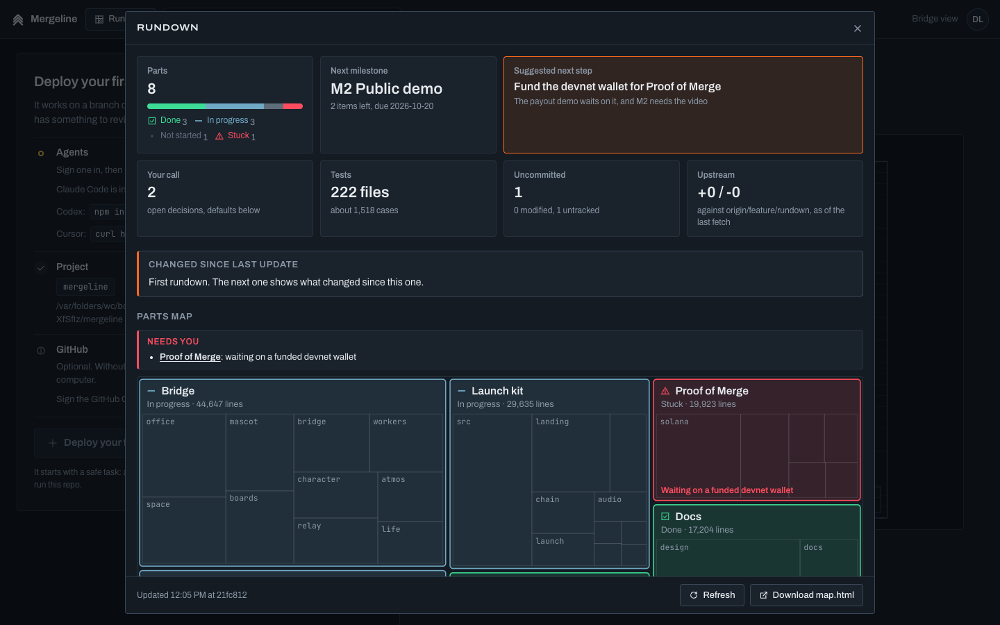
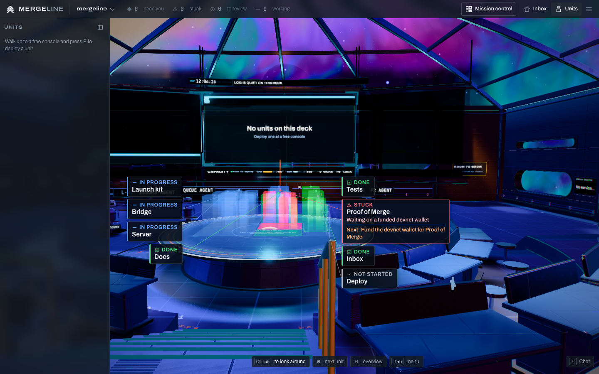

# Rundown

Back to the [README](../README.md).

Rundown is Kipdeck's map of one project: its main parts and how far each has got (done, in progress, not started, stuck), its milestones and what is left before the next one, the suggested next step, what changed since the last look, commit activity, branches and worktrees, and the decisions waiting on you, each with the default the map assumes until you answer.

It comes four ways, from one implementation that ships in the `kipdeck` package and the repository:

- **The office** (Labs > Rundown), for every project it hosts: the Rundown window in the inbox and on the Deck, and the project as a city of light over the Deck's holo table. It builds each project's first map by itself, so the window opens with data and Signal shows the parts ([The office's first map](#the-offices-first-map)).
- **`kipdeck rundown [path]`** in a terminal, in any git checkout, with no office and no Claude: the facts and the parts inferred from them, as the page in `.rundown/` and a short summary.
- **The `/rundown` skill** in Claude Code, in any git checkout, for Claude's own read of the parts, the next step and the decisions. `kipdeck rundown install` adds it. It writes one self-contained page, `.rundown/rundown.html` (the same file as `map.html`), that opens offline with a double-click, and keeps an index of every project's page in `~/.claude/rundown/index.html`.
- **The Claude Code plugin**: the same skill, plus a SessionStart hook that starts every session in a mapped repository with a short brief from its map ([The plugin and the session brief](#the-plugin-and-the-session-brief)).

Until Claude has read a project, the window and Signal's card say so in one line: "Inferred from the code. For Claude's read, run /rundown (kipdeck rundown install adds it to Claude Code)."



## From the command line

```
kipdeck rundown                 the map of the checkout you're in
kipdeck rundown ~/code/api      another checkout
kipdeck rundown --open          and open the page
kipdeck rundown install         add /rundown to Claude Code (~/.claude/skills/rundown/)
kipdeck rundown install --dry-run
kipdeck rundown install --force replace a newer installed copy
```

`kipdeck rundown [path]` runs the skill's own script (`quick`): it collects the facts, takes the parts and statuses from the last `/rundown` judgement when the skill left one and infers them from the folders otherwise, writes `.rundown/` exactly as the skill does (kept out of git through `.git/info/exclude`), and prints the skill's reply block: at most nine lines with where the page is, the milestone road, the next step, what needs you, the parts by status, what changed and the index. `--no-gh` leaves out GitHub's issues and pull requests. The block's next step is the one the office infers from the code when no `/rundown` picked one (marked "inferred from the code"), and before any judgement the parts line says how many folders it counted (*Parts  9 by folder, not assessed yet*). The same guards apply: a path that isn't a folder, or a folder outside any git checkout, stops it with exit 2 and nothing is written; your home folder or `/` is only mapped when named.

`kipdeck rundown install` copies the package's `plugins/rundown/skills/rundown/scripts/rundown.mjs`, `plugins/rundown/skills/rundown/SKILL.md` and `plugins/rundown/skills/rundown/README.md` into `~/.claude/skills/rundown/`, with the installer's list, backup and diff (below). It never replaces a newer installed copy with an older one: it says which two versions it found, changes nothing and exits 3, unless you add `--force` (the old copy is backed up first either way). Kipdeck is not on npm yet, so `npx kipdeck rundown install` finds nothing; `npx https://github.com/zbagdzevicius/kipdeck/releases/latest/download/kipdeck.tgz rundown install` does it without installing Kipdeck, and `npx github:zbagdzevicius/kipdeck rundown install` builds it from this repository first. `kipdeck rundown --help` has the options.

## The skill

```
/rundown           a full read: facts, Claude's judgement, the page (a minute or two)
/rundown quick     facts again, with the last judgement and your edits (a second)
/rundown facts     facts only, as a short summary
/rundown ~/code/x  another checkout
```

A full run collects the facts, Claude reads the repository and writes `.rundown/judgement.json` (the parts, their statuses and evidence, the next step, proposed milestones and new decisions), and the script renders the page. Claude relays the script's reply block as it is, at most nine lines:

```
Rundown · shopfront · ~/code/shopfront/.rundown/rundown.html
Road   M1 ● ━ M2 ◆◐ ┄ M3 ○ ┄ M4 ○    M2 Payments live ▰▰▱▱▱ 2/4 · due Nov 1
Next → Merge the webhook endpoints so paid webhooks return 200 (unblocks 2)
Needs  ▲ D1 Which tax scheme for cross-border sales?  default: margin scheme
       +2 more on the page
Parts  ▲2 ◐4 ○1 ●1
Since  Oct 7: +14 commits · Payments ◐→▲ · M1 done · D3 new
Index  ~/.claude/rundown/index.html · 6 projects
Answer: click an option on the page (copies a prompt) or edit .rundown/decisions.md, then /rundown quick
```

A vague question in the middle of other work ("where are we?") gets a short answer and an offer of `/rundown`, not a map.

The page is a flow read top to bottom, with a section rail in its sticky header: (1) Road, the milestones as a track with "you are here", the active milestone's checklist and a "since last run" chip row; (2) Next, the one next step with its milestone, its part, what it unblocks and a Copy as prompt button; (3) Needs you, the open decisions with the default outlined (each option copies an answer prompt for Claude) and then every stuck part no decision covers, with what it waits on in full; (4) Parts, a status bar and a pill per part that opens its drawer. Under the hood, closed by default, holds the codebase treemap and parts table, the commit heatmap (as many weeks as the repository is old, 8 to 26) with contributors, the branch lanes and worktrees, and the repo's tests, TODO and languages. Every fact has one home on the page; anything else that mentions it links there. Before the first full run there is no Road or Next, and each top folder is a part "not assessed yet". The header's "All rundowns" button opens the index: one card per project you mapped, newest first, with its milestone, next step and what needs you, kept in `~/.claude/rundown/` (`RUNDOWN_HOME` moves it; tests use that). Pages that are gone drop off it, except a project on a drive that isn't mounted right now, and parallel runs take a lock so none drops another's card. A failure writing the index never fails the render. `rundown.mjs index` rebuilds it. It follows the saved style in `~/.claude/agent-memory/project-map/style.md` (`style: dark|light`, `accent: <name or #hex>`, shared with the project-map agent); `--theme` and `--accent` override it for one run.

The script refuses what it shouldn't map: a `--root` that isn't a folder stops it with exit 2 and is never created, and your home folder or `/` is mapped only when named with `--root`. Outside git it lists and opens nothing. In a repository with no commits yet it still reports the branch, the remote and the untracked files ("no commits yet on main"). Tools' caches nobody committed (`.playwright-mcp/`, `.turbo/`, `.cache/` and the like) are not counted as the project's code.

You edit two files, and the map never overwrites them:

- `.rundown/milestones.md`: ordered milestones, each with "Done when:" and a checklist. The first set is proposed by Claude and marked "Proposed: edit me". Later runs only tick items that are clearly done and add notes.
- `.rundown/decisions.md`: write your answer under `Answer:` and run `/rundown quick`, or answer from the inbox ([Your call](#your-call-decisions-and-the-next-step)). Answered ones show as resolved.

The rest of `.rundown/` is the script's: `facts.json`, `judgement.json`, `rundown.json` (the whole model), `state.json` (what the next run diffs against, written last, so a failed run never moves it) and `history/` (the last 20 states). `.rundown/` is kept out of git through the repository's common `.git/info/exclude`, never `.gitignore`. On the first run in a checkout that has the older `.project-map/`, its milestones, decisions and state carry over once.

### Where the script comes from

There is one implementation: the office's own code (`src/server/rundown/` and `src/shared/rundown/`), bundled by `vite.rundown.config.ts` into one dependency-free file for Node 18 or newer, `plugins/rundown/skills/rundown/scripts/rundown.mjs` (part of `npm run build`, or `npm run build:rundown` alone). That file is committed, because the plugin installs straight from git with no build step; `tests/rundown-plugin.test.ts` builds it again and fails when the committed copy is out of date. Its second line is `// rundown-version: x.y.z`, from `RUNDOWN_VERSION` in `src/shared/rundown/version.ts`: raise it with every change people would notice in the script, the page or the skill, together with the version in `.claude-plugin/plugin.json` and `marketplace.json`. The skill's own files are `plugins/rundown/skills/rundown/SKILL.md` and `plugins/rundown/skills/rundown/README.md`. All three are in the npm package (its `files` list has `plugins/rundown/skills/rundown`), so an installed Kipdeck carries the skill. There is no copy under this repository's `.claude/skills/`, so a project skill never shadows the global one.

`kipdeck rundown install` puts the script, `SKILL.md` and `README.md` into `~/.claude/skills/rundown/`, which makes `/rundown` work in every directory; `SKILL.md` runs the script beside it, `<the skill's folder>/scripts/rundown.mjs`. It reads the installed copy's version first (the stamp, or the `VERSION` constant of the older 1.0 and 1.3 builds) and stops over a newer one unless given `--force`. Before it changes anything it lists what is new, changed, unchanged and taken out (the scripts of an older install), copies the whole old folder to `~/.claude/backups/rundown-<time>/`, and prints a `diff -ru` command to compare. `--dry-run` only prints the list and `SKILL.md`'s diff. Screenshots in the installed `examples/` are left alone. The bundled script does the same on its own (`node plugins/rundown/skills/rundown/scripts/rundown.mjs install`): it finds `SKILL.md` and `README.md` beside it in the package, or takes `--skill` and `--readme`. In a source checkout, `npm run rundown:install` builds the script first. Changing `SKILL.md` needs no build; changing the collector or the page means rebuilding (and installing again for the global copy).

## The plugin and the session brief

The repository is a Claude Code plugin marketplace with one plugin, `rundown`:

```
/plugin marketplace add zbagdzevicius/kipdeck
/plugin install rundown@kipdeck
```

The plugin lives in its own folder, `plugins/rundown/`, so installing it copies only the skill and the hook, never the rest of the repository (and Claude Code never runs `npm install` on the office's `package.json`). `plugins/rundown/.claude-plugin/plugin.json` names it, `.claude-plugin/marketplace.json` at the repository's root lists it (source `./plugins/rundown`), its skill is `plugins/rundown/skills/rundown/`, and `plugins/rundown/hooks/hooks.json` adds one SessionStart hook, `node "${CLAUDE_PLUGIN_ROOT}/skills/rundown/scripts/rundown.mjs" session-start`. Claude Code lists a plugin's skill under the plugin's name, `rundown:rundown`.

At the start of a session (a new one, a resume, after `/clear` or a compaction) the hook reads the session's folder from its input, finds the map at that folder's git top (outside git, the nearest `.rundown/rundown.json` at or above it, never above the home folder), and, when that map was judged by Claude and is less than 7 days old, prints a brief of at most 1.5 KB that Claude Code adds to the session's context:

```
Project rundown for shopfront (.rundown/, updated 2d ago; /rundown quick refreshes it, .rundown/rundown.html is the full map):
- Milestone: M2 Payments live, 2/4 items done, due 2026-11-01. Open: Refunds; Tax report
- Next step: Merge the webhook endpoints (why: Refunds wait on them)
- Open decisions: D1 Which tax scheme for cross-border sales? (default: margin scheme)
- Stuck: Payments, waiting on a funded devnet wallet from finance
Open decisions run on their defaults until the user answers them in .rundown/decisions.md.
```

It only briefs from a map this machine wrote: the git top's `.rundown/` has to be kept out of git by the script's line in `info/exclude` (written on the first render) and must not be in git's index. A repository that commits its own `.rundown/` can't put text into your session that way.

When the lists don't fit, the last items go and the line says how many more there are. An older map, a map of folders only, or no map at all adds nothing. The hook only reads that one file: it writes nothing, runs no git and always exits 0 within its 10 s timeout, so it never holds up or fails a session. The brief comes from `src/shared/rundown/session-brief.ts` and the hook from `src/server/rundown/session-start.ts`.

## In the office

Switch on Labs > Rundown (or start with `--labs rundown`). Then:

- **In the inbox:** Rundown in the avatar menu and Ctrl+K opens the window for the picked project. It has a tab per project, Refresh, and Download map.html (the same page the skill writes).
- **In Needs you:** each open decision is a row, and the map's next step is **Deploy on: <step>** (see [Your call](#your-call-decisions-and-the-next-step)).
- **On the Deck:** Rundown in the menu (Tab) and Ctrl+K opens the window for the deck you're on. **Rundown on the holo** raises the city over the mission table. While it's up the holo's star map, course column, waypoint plates and the heading's caption ("NO COURSE SET") all stand down, so nothing is written over the city. E at a district opens the window at that part; at the next step's orange beam E deploys an agent on the step instead (Ctrl+K has it too, as Deploy on: <step>), and R opens the window. The window's ✕ or Esc puts you straight back into mouse-look.



The city: a district per part, laid out like the treemap and sized by its lines of code, up to six towers for its biggest folders, filling the table inside the milestone rings and standing on a plane a little over the tabletop so it clears the table's lip from the conn. Done parts glow green, parts in progress blue, parts not started are a faint grey wireframe, and a stuck part is red and blinks slowly. Only a stuck part is bright enough to bloom: every other colour is capped under the bloom's threshold, and the towers write depth, so looking along a row of them adds the nearest one or two rather than summing to a white blur. Each commit of the last 7 days sends a pulse up the towers of the parts it touched, and a district with uncommitted changes shimmers. The milestones are rings round the table's rim: solid when done, the active one orange with its done share lit, the ones ahead dashed. An orange beam rises from the next step's district. A short chime plays when a part changes status. With reduced motion or Ship motion Off the city holds still, and at Low quality there are no pulses.

Every district has a callout: its status as a glyph and a word, its name at 15 px, what a stuck part waits on, and on the next step's district the step itself. The callouts stand in two columns beside the city, each level with its district as far as the others allow and tied to it by a hairline, so none covers another or the city, from the conn, the pit or the side. They are part of the page over the 3D view, not the scene, so they read at any distance and cost no draw. They hide while a window is open and when you're more than 22 m from the table.

It draws nothing while it's down or the tab is hidden. Up, it costs at most four draws (towers, lines, rings, pulses) and puts away more than that: from the conn the perf probe measured 374 draws with the city up against 393 with it down at High (budget 400), and the shots 211 against 219 at Medium. `node design/shoot-rundown.mjs` fails if the city ever costs more than what stands down for it, or goes over the tier's budget; `node design/perf-probe.mjs` times the conn with the city up once it says it's built.

### Your call: decisions and the next step

With the lab on, every open decision in a project's `.rundown/decisions.md` waits in the inbox's Needs you as a row of its own: *Decide: Which host?*, with *default: Vercel, open 3d* and, when an agent raised it, who asked. Only decisions written in `decisions.md` count; ones Claude inferred but nobody wrote down stay in [Signal](signal.md). An admin has two buttons on the row:

- **Keep default** answers with the default.
- **Choose...** opens the decision with its options (the default marked) and a line for something else. Its ✕ and Esc close it without answering.

An answer is one narrow edit (`src/server/rundown/answer.ts`): it fills in that decision's empty `Answer:` line, or adds one at the end of its block, and changes no other byte of the file. The page sends the file's modification time as it saw it, and when the file changed since (you edited it, or `/rundown` ran), nothing is written and the page is shown the file again. The office refuses a `.rundown/` or `decisions.md` that is a symlink or leads out of the checkout, and writes the file whole through a new file renamed over the old one. A `decisions.md` that isn't a plain file, or is over 512 KB, is left alone too: nothing is answered or raised in it. Then it draws the skill's page in `.rundown/` again (quick mode, from the facts the last run left there; skipped when anything there is a symlink), and when an agent raised the decision it tells that agent the answer in its own session, waking it if it was asleep. People who aren't admins see the rows and the decision, but not the buttons.

The map's one suggested next step (the skill's, else the office's own) shows as **Deploy on: <step>** on the empty pane and in Ctrl+K. It opens the Deploy sheet on that project with the step as the task, stamped with where it sits: *From the rundown of api, on M5 Server - Server.* On the Deck, E at the orange beam does the same through the Deck's own Ask window.

The office looks at every project's `decisions.md` and next step every 15 s while a page listens (two small file reads a project, no git), and at once after an answer or a raise. The read-only demo hears none of it.

#### Raising a decision: `kipdeck decide`

An agent that needs a person's call asks for it and goes on with the default:

```
kipdeck decide "Which host?" --options Vercel,Fly --default Vercel
kipdeck decide "Which queue?" --options SQS,Redis --part jobs
```

Two to six options, separated by commas; the default is the first unless `--default` names one of them. Run by an agent Kipdeck started, it goes to the office over the loopback hook port, as the agent itself (its `AGENT_OFFICE_WORKER_ID` and `AGENT_OFFICE_HOOK_TOKEN`): the decision is added to Open in its project's `decisions.md` with a `Raised by:` line naming the agent, it shows in Needs you at once, and the answer comes back later as a message in the agent's session. With the Rundown lab off it is refused, and the agent is told to go on with its default. Run anywhere else, it writes the decision straight into `.rundown/decisions.md` of the checkout it runs in, for the next `/rundown` and Kipdeck to pick up. Either way `.rundown/` stays out of git through `.git/info/exclude`.

### The office's first map

When a project opens in the office (at start, added, or cloned) with the Rundown lab on, or the lab comes back on, the office builds that project's map once in the background, with nobody watching: the facts and the inferred parts, no Claude, through the same one-at-a-time queue, 2 s after the project opens (`PRIME_DELAY_MS`) so starting the office isn't slowed. It happens once per project for as long as the office runs. After that the map moves on while someone watches it, as below, and when Signal peeks at the project: at most once a minute (`POLL_MS`) the peek looks at HEAD and the working tree, and only when either moved does it queue a new map, whose gist the office then sends out. A merge on that floor queues one too. There is no timer of its own. So the Rundown window opens straight onto a map, never "Computing the first rundown...", and Signal's card has the parts and a next thing to show before anyone opens the window ([Signal](signal.md)).

The office keeps that map in its own memory. It writes nothing else into the project's `.rundown/`, which stays the skill's and yours (the exceptions are an answer or a raised decision in `decisions.md`, and the page drawn again after an answer, above); otherwise the only file it touches is its own diff base, `.agent-office/rundown/state.json`, as it always has, and only once someone opens the window: a map built with nobody watching doesn't move it, so restarting the office or a peek never uses up "Changed since last update". Signal reads the map from memory. If the Rundown lab goes off in the 2 s before a first map starts, it isn't built, and the lab coming back on asks again. A restart builds it again. In the read-only demo there is no first map, as there is no rundown at all.

### What the office knows without Claude

The office computes a project's map itself, with the same collector, once when the project opens (above) and whenever someone has it open: the facts, and parts inferred from the folders with statuses worked out from activity (changes or commits in the last 14 days are in progress, under 50 lines not started, the rest done; never stuck, since only a person or Claude can say what something waits on). The window says so: "Inferred from the code. For Claude's read, run /rundown (kipdeck rundown install adds it to Claude Code)." Its suggested next step is then the one Signal's card works out from the code (the first open item of your next milestone, else the part with the most uncommitted work, else the part in progress that moved last, with the day of its last commit); the banner says it's inferred, so the tile doesn't repeat it. The downloaded page and `kipdeck rundown` show the same step. Once the skill has run in the project, the office takes the parts, statuses, evidence and next step from its `.rundown/rundown.json` (read only, 512 KB at most, checked) and your milestones and decisions from the two markdown files, with its own numbers. The office never writes into `.rundown/` except for Your call's two edits to `decisions.md`; what it diffs against is its own `.agent-office/rundown/state.json`, moved on when the project's HEAD moves, or when its last look was 30 minutes or more ago, so "Changed since last update" also shows uncommitted work and status changes since you last looked.

Past its first map, it computes only while someone watches a project, one project at a time across the building, and looks again when HEAD or the working tree moved (checked every minute) or a pull request merged on that floor. Refresh is allowed once every 30 seconds per project. The download waits at most 45 s for a map and answers 503 rather than hang (a project taken off the building or the office closing while it waits also answer at once). A failed computation tells the page only "Couldn't read this project"; the detail, which may name server paths, goes to the office's log.

## The data model

One type, `Rundown` in `src/shared/rundown/schema.ts` (schema version 1), shared by the skill, the page, the window and the city:

| Field | What | Who fills it |
| --- | --- | --- |
| `project` | name, root, `owner/name` remote, default branch, HEAD, description | collector (Claude may sharpen the description) |
| `facts` | git (branches with ahead and behind, worktrees, recent commits, activity by day, contributors, uncommitted, upstream as of the last fetch), files (languages, folders, largest, manifests, tests, TODO locations, docs, CI), GitHub, gaps | collector |
| `parts` | id, name, summary, path globs, status, who decided it, what a stuck part waits on, evidence | Claude, or inferred from folders |
| `parts[].metrics` | lines, files, test files, TODO and FIXME, commits in 30 days, last commit, uncommitted | computed from the facts and the globs |
| `milestones`, `nextMilestone` | from `milestones.md`, or proposed | you, then Claude only ticks |
| `nextStep` | one action and why | Claude |
| `decisions` | question, options, default, raised date, your answer | Claude or an agent (`kipdeck decide`) raises, you answer |
| `changes` | what changed since the last state, weighted | computed |

## Security and limits

Everything is read only except Your call's two edits to `decisions.md` (above), and nothing in the mapped project runs:

- Git runs through `execFile` with fixed arguments, never a shell, each call with a 10 s timeout and a 16 MB buffer, with `GIT_OPTIONAL_LOCKS=0` (status never writes the index), no pager, no prompt, and `core.fsmonitor`, the untracked cache and signature checks switched off; `log` adds `--no-ext-diff --no-textconv`. Nothing fetches, checks out or writes a ref. `gh` is used only by the skill, optionally, for 15 s at most; the office uses its own GitHub cache.
- Files come from `git ls-files` (tracked, and new ones not ignored), never a folder walk. `.git/`, `.agent-office/` (the workers' worktrees), `.rundown/`, `.project-map/`, `.claude/worktrees/`, `node_modules/`, nested repositories and symlinks are left out; lockfiles, minified and built files are listed but not counted in lines.
- Files that may hold secrets or personal data (`.env*`, keys and keystores, anything named for credentials, secrets or a vault, dumps, backups, logs) are counted and never opened. Binaries are skipped. TODOs are recorded as path, line and tag, never their text. Contributors are display names, never emails. Remote URLs lose any credentials.
- Caps: 50,000 files, 1 MB read per file and 200 MB per run, 20 s for the skill and 15 s for the office (partial results say so), 40 branches and worktrees, 30 recent commits, 182 days of activity.
- The office computes only for floors of its building, named by id; a page never sends a path. The download route needs a signed-in session and the lab. In the read-only demo there is no rundown at all: the download route isn't there, and watching is dropped without a word (contributors, uncommitted paths, TODO locations, branches and decisions are not for anonymous visitors).
- The page embeds only the model, never file contents, and makes no request of any kind (its own policy forbids them).

## For developers

- `src/shared/rundown/`: the model (`schema.ts`, `model.ts`, `infer.ts`, `diff.ts`, `markdown.ts`, `validate.ts`), the layouts (`treemap.ts`, `heatmap.ts`, `branches.ts`, `paths.ts`) the page (`html.ts` putting together `page-flow.ts` for Road, Next, Needs you and Parts, `page-hood.ts` for under the hood, `page-css.ts`, `page-js.ts` and `page-svg.ts`, with `view.ts` for what the page, the reply and the brief read off the model), the index page (`index-page.ts`), the reply block (`reply.ts`), the session brief (`session-brief.ts`) and the version (`version.ts`). Pure.
- `src/server/rundown/`: the collector, the office's service (`service.ts`) and each floor's first map (`first.ts`), Your call (`yourcall.ts`, with the writer `answer.ts`, the hook route `decide-hook.ts` and `kipdeck decide` in `decide.ts`; its words in `src/shared/yourcall.ts`, its edits pure in `src/shared/rundown/answer.ts`, its messages in `src/shared/protocol/yourcall.ts` and `ws/handlers/yourcall.ts`), the skill's CLI (`cli.ts`, with `install.ts`, `index-file.ts` for the index of every project and `session-start.ts` for the plugin's hook) and `kipdeck rundown` (`command.ts`, found through the command registry `src/server/commands.ts`). `ws/handlers/rundown.ts` (watch, unwatch, refresh) and `http/routes/rundown.ts` (the download), gated by `ws/labgate.ts` and the route's `lab`.
- `src/client/ui/rundown/`: the window, loaded lazily by the inbox (`home/lazy.ts`) and the bridge. `state/slices/rundown.ts` keeps what the office sent per floor.
- `src/client/features/rundown/`: the holo city (`world.ts` the fixture, `city.ts` the meshes and shaders, `labels.ts` and `callouts.css` the callouts, `logic.ts` the pure layouts of the city and the callout columns, `sound.ts`), its menu rows and Ctrl+K entries, and E at a district. `Holo.yieldTo` in `features/bridge/holo.ts` and `HoloHeading.yieldTo` in `features/life/heading.ts` are the seams it uses there.
- Tests: `tests/rundown-*.test.ts` (the model, the diff, the markdown files, validation, layouts, the collector against a repository with traps in it, the handlers and route, and the built script and its page in a headless browser). `tests/rundown-command.test.ts` has the command's arguments, the registry and the first map; `tests/rundown-ship.test.ts` packs the package, installs the skill from it into a throwaway HOME (and checks a newer copy is kept unless forced) and maps a fixture with `kipdeck rundown`; `tests/rundown-index.test.ts` has the index of every project; `tests/rundown-plugin.test.ts` checks the committed script against a fresh build, the version guard, the plugin's files, the session brief and the hook as the plugin runs it, the reply block and the flow page; `tests/rundown-first-e2e.test.ts` starts an office on a fresh project and opens the window and Signal's card in a browser (`RUNDOWN_FIRST_SHOTS=<dir>` saves screenshots of both). Screenshots: `node design/shoot-rundown.mjs` after `npm run build`, into `design/shots/rundown/final/`; it also checks every callout is on screen, at 14 px or more, and clear of the others, from the conn, the pit and the side. `FLICKER_RUNDOWN=1 node design/flicker-check.mjs` sweeps the table with the city up.
