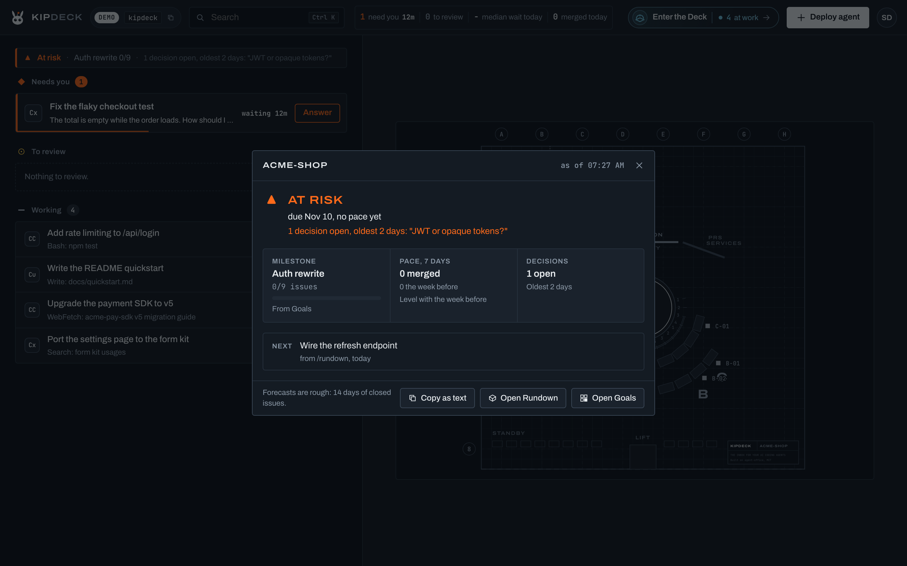

# Signal

Kipdeck's one-look project status for whoever leads the project: on track, at risk or off track, and why.

Back to the [README](../README.md).

Signal sits at the head of the inbox list, over the sections, as one line: a glyph, a status word, the milestone with how far it got, and the rule that set the status. It reads the project picked in the top bar. Under All projects it reads the floor you're on, else the first, and with more than one project the chip names it first (*acme-shop - Auth rewrite 5/9*). A click opens the card. It's also **Signal** in the avatar menu and in Ctrl+K, next to Rundown. It's part of the inbox, not a lab, and still shows with every lab switched off.

## The four statuses

Each one reads by its shape alone, in grayscale too:

| Glyph | Status | When |
| --- | --- | --- |
| ● | On track | There is a milestone, and no rule below fired. |
| ▲ | At risk | The forecast lands too close to the due date, a decision is open, someone has waited on you for over an hour, or merges fell off. |
| ■ | Off track (red) | The milestone is past its due date with issues left, an agent on this milestone is stuck, or `/rundown` marked a part stuck. |
| ○ | No goal (muted) | Neither Goals nor a recent `/rundown` has a milestone. Signal never says On track just because it knows nothing. |

At risk turns Signal orange only when a person can clear it (an open decision, a long wait on you), since orange in Kipdeck always means someone is needed. Otherwise it stays steel.

## The rules

Every threshold is a named constant in `src/shared/signal.ts`:

- **Off track**: past the due date (from the day after it) with issues left; a stuck agent linked to the shown milestone (its roster entry's `goal`), snoozed ones left out; or a part the `/rundown` skill marked stuck (an inferred status never counts). A crashed or stuck agent on other work stays in the inbox and doesn't move the project's status.
- **At risk**: the forecast lands later than `RISK_MARGIN_DAYS` (2) days before the due date, or no issue of the milestone closed in a whole `BURN_DAYS` (14) day window, since at that pace it never lands; an open decision in the last `/rundown`; a Needs you wait over `LONG_WAIT_MS` (1 hour); or this week's merges under `PACE_DROP` (half) of the week before, once the week before had at least `PACE_MIN_BEFORE` (4).
- Off track wins over At risk, and the card lists at most three reasons, Off track's first.

## Where the milestone comes from

Goals comes first, because it's live: the active milestone in Mission control's Goals tab (the Goals and timeline lab), with its issues closed out of the issues it lists. Only when Goals has no active milestone does Signal show the next milestone from the last `/rundown`, with its items done out of all. The card says which source it shows.

A `.rundown/rundown.json` that is `STALE_RUNDOWN_DAYS` (7) days old or more feeds nothing (its age is the older of the skill's `generatedAt` and the file's modification time, so an old rundown that was copied or pulled stays old): no milestone, no decisions, no stuck parts, no next step. The card says how old it is and suggests running `/rundown` again.

## The forecast

For a Goals milestone with a due date, the card says *due Oct 24, pace says ~Oct 27 (rough)*. The pace is the milestone's issues closed over the last `BURN_DAYS` (14) days, from the timeline's progress events, which is the same count the Deck's fleet log uses (`issuesClosed` in `src/shared/pace.ts`). A milestone younger than 14 days (counted from its *added the milestone* line on the timeline) is measured over its own days; when the timeline no longer has that line, its age is unknown and the whole 14 days count, and with nothing closed yet the card says *no pace yet*, which sets no rule. Once a whole 14 days pass with nothing closed, the status is At risk: *No issues closed in 14 days*. A `/rundown` milestone has no pace to go by, so it shows only its due date. Past the due date, the card says how many days late it is, and the reason says what's left.

## The card

- The project, the status with its reasons, and the forecast.
- **Milestone**: the title, done out of all, and where it came from. A milestone with no issues yet says so on the chip rather than 0/0.
- **Pace, 7 days**: merges in the last 7 days from the signed shipped log, against the 7 before.
- **Decisions**: the open ones in the last `/rundown`, the oldest one's age and its question (the gist carries the oldest few by name, whatever order `decisions.md` lists them in) (left out when the reason above already quotes it).
- **Next**: the `/rundown` skill's next step and how old it is, else *Answer* the agent that has waited on you longest.
- **Copy as text** puts one line on the clipboard, plain ASCII, ready for Slack: *acme-shop: At risk. Auth rewrite 5/9 issues, due Oct 30, pace says ~Oct 27 (rough). 1 decision open: "JWT or opaque tokens?". 12 merged this week (9 the week before). Next: Wire the refresh endpoint.*
- **Open Rundown** while the Rundown lab is on, and **Open Goals** while Goals can be reached (the Goals and timeline lab and the GitHub boards and queue lab, which Mission control sits behind) and the card is about the floor you're on. With No goal, the chip and the card name the same thing to do: set a goal, run `/rundown`, or turn a lab on (the GitHub boards lab when only it is off). In the read-only demo they suggest nothing and offer neither window, since a visitor can't act on them.

The top-right ✕ and Esc close it.

## Freshness, and what the office reads

Most of what Signal shows is already on the page: the Goals milestone of the floor you're on, the ranking and the shipped log. The rest comes in a small gist over the socket (`signal.peek` and `signal.gist`, in `src/shared/protocol/signal.ts`): the Goals milestone of a project you aren't on, its issues closed lately, and what the last `/rundown` left in `.rundown/`. The office reads `rundown.json` through Rundown's own `skillJudgement()` (capped at 512 KB and checked), with the person's `milestones.md` and `decisions.md` over the skill's guesses, and keeps the gist per project until one of those files changes. It never runs git, never computes a map and never polls. The page asks when it connects, when the project picked changes, when the tab comes back into view (at most once a minute), when a milestone moves on the timeline and when the Rundown window's map of the project changes. The office answers one peek per project a second (`PEEK_GAP_MS`); the page holds a sooner one back until then rather than lose it. A peek names a project by its id only, never a path. Each part of the gist follows its own lab, and the read-only demo drops the message without a word.

## For developers

- `src/shared/signal.ts`: the rules, the forecast, the chip's words and the copy line (`tests/signal.test.ts`).
- `src/server/signal/gist.ts` and `src/server/ws/handlers/signal.ts`: the gist and its handler (`tests/signal-gist.test.ts`).
- `src/client/state/slices/signal.ts`: the gists the page has, by project.
- `src/client/home/signal.ts`: the chip, and what it asks for when.
- `src/client/ui/signal/`: the card, loaded the first time it opens (`home/lazy.ts`).
- `tests/signal-e2e.test.ts` walks every status in a browser, and `node --import tsx design/shoot-signal.ts` (after `npm run build`) shoots the chip and the card in each status, dark and light, at 1440 px and on a phone.
